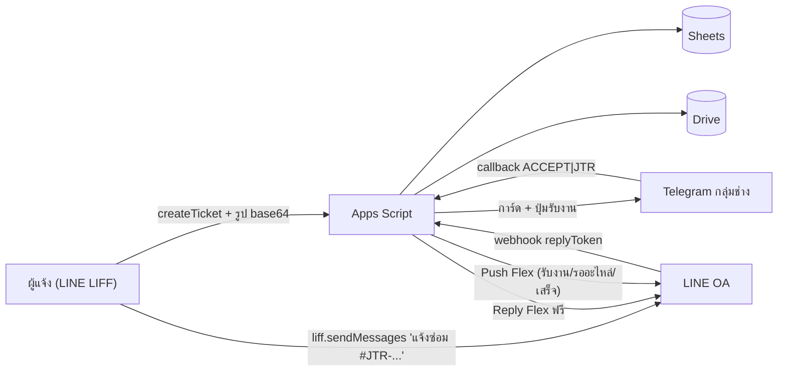

# e-MMS — e-MaintenanceManagementSystem
### ระบบบริหารจัดการงานซ่อมบำรุงออนไลน์ ผ่าน LINE OA (งบประมาณ 0 บาท)

> [!IMPORTANT]
> **อ่านไฟล์นี้ให้จบก่อนลงมือทำงานทุกครั้ง** (ทั้งคนและ AI agent ในแชทใหม่)
> ไฟล์นี้คือ "สมุดบันทึกโครงการ" — ทุกครั้งที่ทำงานเสร็จ ให้อัปเดตหัวข้อ
> [สถานะปัจจุบัน](#5-สถานะปัจจุบัน-current-status) และ [บันทึกการเปลี่ยนแปลง](#12-บันทึกการเปลี่ยนแปลง-changelog) ด้วยเสมอ

**อัปเดตล่าสุด:** 1 พ.ย. 2569 (2026-11-01)

---

## สารบัญ
1. [โครงการนี้คืออะไร](#1-โครงการนี้คืออะไร)
2. [เทคโนโลยีที่ใช้](#2-เทคโนโลยีที่ใช้-tech-stack)
3. [ข้อมูลระบบจริง (IDs / URLs)](#3-ข้อมูลระบบจริง-ids--urls)
4. [โครงสร้างไฟล์](#4-โครงสร้างไฟล์)
5. [สถานะปัจจุบัน](#5-สถานะปัจจุบัน-current-status)
6. [มติการออกแบบ 20 ข้อ (ห้ามเปลี่ยนโดยไม่ถามเจ้าของ)](#6-มติการออกแบบ-20-ข้อ)
7. [ฐานข้อมูล 15 ชีต](#7-ฐานข้อมูล-15-ชีต)
8. [Workflow ของระบบ](#8-workflow-ของระบบ)
9. [API Actions](#9-api-actions-liff--apps-script)
10. [วิธีพัฒนาและ Deploy](#10-วิธีพัฒนาและ-deploy)
11. [ข้อควรระวัง / Gotchas](#11-ข้อควรระวัง--gotchas)
12. [บันทึกการเปลี่ยนแปลง](#12-บันทึกการเปลี่ยนแปลง-changelog)
13. [งานที่เหลือ / ไอเดียเฟสถัดไป](#13-งานที่เหลือ--ไอเดียเฟสถัดไป)

---

## 1. โครงการนี้คืออะไร

ระบบแจ้งซ่อมภายในองค์กรของ **สถาบันพัฒนาการชลประทาน / วิทยาลัยการชลประทาน** สำหรับเจ้าหน้าที่ อาจารย์ แม่บ้าน/รปภ. และนักศึกษา

- **ผู้แจ้ง** ใช้งานผ่าน **LINE OA** (เปิดหน้าเว็บ LIFF จาก Rich Menu) → แจ้งซ่อมพร้อมรูป → รับแจ้งเตือนสถานะทาง LINE
- **ทีมช่าง** รับแจ้งเตือนงานใหม่ใน **กลุ่ม Telegram** → กดปุ่ม "รับงาน" → อัปเดต/ปิดงานผ่านหน้าเว็บ LIFF เดียวกัน
- **Admin** ดู Dashboard สถิติตามปีงบประมาณ, สถิติช่างรายบุคคล, จัดการผู้ใช้, Export CSV
- **ข้อมูลทั้งหมด** เก็บใน Google Sheets, รูปเก็บใน Google Drive

**ที่มา:** ระบบเดิมใช้ Google Sheets + AppSheet + แจ้งเตือน Telegram (มีงาน 630 รายการ ธ.ค. 2567 – ต.ค. 2569)
→ **ตัดสินใจเริ่มฐานข้อมูลใหม่ทั้งหมด ไม่ย้ายข้อมูลเก่า**

**เป้าหมายการใช้งาน:** 1–2 งาน/วัน, ผู้ใช้พร้อมกัน 3–4 คน → อยู่ในโควต้าฟรี 100%

**ทีมช่าง (จากระบบเดิม):** สุรชาติ, ทิตติพงค์, พิชัย, นพพล, พีระชัย

---

## 2. เทคโนโลยีที่ใช้ (Tech Stack)

| ส่วน | เทคโนโลยี | หมายเหตุ |
|---|---|---|
| Frontend | HTML + Vanilla JS + **Tailwind CSS (CDN)** + **Chart.js** + **LINE LIFF SDK v2** | ไม่มี build step — แก้ไฟล์แล้ว push ได้เลย |
| Hosting หน้าเว็บ | **GitHub Pages** | repo `TopseasoN/e-mms`, branch `main`, root |
| Backend / API | **Google Apps Script** (V8) Deploy เป็น Web App | `doPost` รับทั้ง LIFF API + LINE Webhook + Telegram Webhook ใน URL เดียว |
| Database | **Google Sheets** (15 ชีต) | ใช้ `LockService` กันรหัสซ้ำ |
| เก็บรูป | **Google Drive** | แยกโฟลเดอร์อัตโนมัติ `2569-10/` (ปี พ.ศ.-เดือน) |
| แจ้งเตือนผู้แจ้ง | **LINE Messaging API** | Reply (ฟรี) + Push (≤300/เดือน) แบบ Flex Message |
| แจ้งเตือนช่าง | **Telegram Bot API** | Inline Button "รับงาน" + สรุปงานค้าง 08:00 |
| Deploy backend | **clasp** (`@google/clasp`) | `rootDir: apps-script` |

---

## 3. ข้อมูลระบบจริง (IDs / URLs)

| รายการ | ค่า |
|---|---|
| Apps Script **Script ID** | `1_gCIrGV1c5HL0lzXUSTsJl8fpmTvaj9jDNupNivhT_d4TlEIlrsjK87f` |
| Web App **Deployment ID** (ใช้ ID นี้ตลอด ห้ามสร้างใหม่) | `AKfycbxg71MIIDI5RtmBiM-dl1NZLjNFnbc6rWO46OyZ9GdVam39udnPFcd0zqQzezpxNUk` |
| **Web App / Webhook URL** (LINE + Telegram + LIFF API) | `https://script.google.com/macros/s/AKfycbxg71MIIDI5RtmBiM-dl1NZLjNFnbc6rWO46OyZ9GdVam39udnPFcd0zqQzezpxNUk/exec` |
| Deployment version ล่าสุด | `@5` |
| GitHub repo | https://github.com/TopseasoN/e-mms |
| GitHub Pages (หน้าเว็บ LIFF Endpoint) | https://topseason.github.io/e-mms/web/ |
| LINE Login Channel ID | `2012286335` |
| LIFF ID | อยู่ในชีต `Sys_Config` → `LIFF_ID` (รูปแบบ `2012286335-xxxxxxxx`) |
| Google Drive โฟลเดอร์รูป | `1VSmtUyahQ3XTytpap1IROfKO_jTTP-ez` |
| Telegram Chat ID กลุ่มช่าง | อยู่ในชีต `Sys_Config` → `TELEGRAM_CHAT_ID` |
| Admin เริ่มต้น | username `thanawat.b` (USER0001, นายธนาวัฒน์ บุตรศรี) |

**Secrets** เก็บใน Apps Script → Project Settings → **Script Properties** (ตั้งค่าเรียบร้อยแล้ว — **ห้ามใส่ในโค้ดหรือในชีต**):
- `LINE_CHANNEL_ACCESS_TOKEN`
- `LINE_LOGIN_CHANNEL_ID`
- `TELEGRAM_BOT_TOKEN`

---

## 4. โครงสร้างไฟล์

```text
e-MMS_ระบบบริหารจัดการงานซ่อมบำรุงออนไลน์/
├── README.md                ← ไฟล์นี้ (อ่านก่อนเสมอ)
├── AGENTS.md                ← กฎสำหรับ AI agent (บังคับอ่าน README ก่อน)
├── index.html               ← redirect หน้า root ของ GitHub Pages → ./web/
├── .clasp.json              ← scriptId + rootDir: apps-script
├── .gitignore               ← ซ่อน Databases/ (ข้อมูลส่วนบุคคล) ไม่ขึ้น GitHub
│
├── apps-script/             ← Backend (push ด้วย clasp)
│   ├── appsscript.json      ← V8, Asia/Bangkok, webapp: USER_DEPLOYING + ANYONE_ANONYMOUS
│   ├── Code.js              ← doGet/doPost router, routeApiAction_, initializeSystemAll()
│   ├── SetupDatabase.js     ← ★ แหล่งความจริงเดียวของ schema (DB_SCHEMA) + seed + setupDatabase()
│   ├── DbUtils.js           ← readTable_/appendRowObj_/updateRowById_, nextId_ (LockService),
│   │                          nextTicketId_ (JTR-YYMM-NNN), uploadBase64ToDrive_, getMasterBootstrap_
│   ├── AuthService.js       ← verify LINE idToken, auto-login, bindLine (username/password), rate-limit
│   ├── TicketService.js     ← create/cancel/accept/updateStatus, duplicate check, Trans_Assignments
│   ├── LineService.js       ← Flex Message, Reply (ฟรี), Push + quota counter, LINE webhook handler
│   ├── TelegramService.js   ← การ์ดงาน, ปุ่มรับงาน, /link /pending /chatid, daily summary, setupTelegramWebhook
│   └── AdminService.js      ← จัดการผู้ใช้, reset LINE, dashboard ปีงบประมาณ + สถิติช่าง
│
├── web/                     ← Frontend (GitHub Pages)
│   ├── index.html           ← SPA ทุกหน้า (Login, แจ้งซ่อม, งานของฉัน, คิวช่าง, Dashboard, ผู้ใช้)
│   ├── app.js               ← logic ทั้งหมด (LIFF init, callApi, ย่อรูป canvas, render)
│   └── config.js            ← API_URL (ตั้งแล้ว), LIFF_ID (ว่าง = ดึงจาก Sys_Config อัตโนมัติ)
│
├── docs/
│   ├── BLUEPRINT.md         ← สถาปัตยกรรม, มติ 20 ข้อ, diagram, โควต้า, roadmap
│   ├── DATABASE.md          ← Data dictionary + ER diagram (สร้างอัตโนมัติ ห้ามแก้มือ)
│   └── SETUP_GUIDE.md       ← คู่มือตั้งค่าทีละคลิก: Sheets, Drive, Telegram, LINE OA/LIFF, Script Properties, Rich Menu
│
├── tools/
│   └── export_schema.js     ← node tools/export_schema.js → สร้าง CSV + docs/DATABASE.md จาก DB_SCHEMA
│
└── Databases/               ← (gitignored) ข้อมูลระบบเก่า + CSV schema v1
    ├── Old_ระบบแจ้งซ่อมออนไลน์ - Inbox.csv / Data_สถานที่.csv   ← ระบบเดิม (อ้างอิงเท่านั้น)
    ├── e-MMS_Databases - *.csv                                  ← ร่างแรกของเจ้าของ
    └── e-MMS_v1/*.csv                                           ← schema v1 (generated)
```

---

## 5. สถานะปัจจุบัน (Current Status)

| เฟส | งาน | สถานะ |
|---|---|---|
| 1 | สัมภาษณ์ความต้องการ (`/grill-me` 20 ข้อ) + ออกแบบฐานข้อมูล 15 ชีต | ✅ เสร็จ |
| 2 | Backend Google Apps Script ครบทุกโมดูล + push ด้วย clasp + Deploy `@5` | ✅ เสร็จ |
| 3 | Frontend LIFF Web App + ขึ้น GitHub Pages | ✅ เสร็จ |
| 4 | คู่มือตั้งค่า (SETUP_GUIDE.md) รวม Rich Menu | ✅ เสร็จ |
| 5 | **ทดสอบใช้งานจริง (UAT)** | 🟡 **กำลังทำ** |

**ตั้งค่าที่เจ้าของทำเสร็จแล้ว:** สร้าง Google Sheets + รัน setup, Script Properties ครบ 3 ค่า, LINE OA + Messaging API + Webhook URL, LINE Login Channel + LIFF, Telegram Bot, Google Drive โฟลเดอร์รูป, GitHub Pages

**ปัญหาที่เจอและแก้แล้ว:**
- ❌→✅ ส่งใบแจ้งซ่อมแล้ว error "รหัสไฟล์หรือโฟลเดอร์ไม่ถูกต้อง" → เพราะใส่ลิงก์ Drive เต็ม/มี `?lfhs=2` → เพิ่ม `extractDriveId_()` ตัดให้อัตโนมัติ (Deploy `@5`) — **รอเจ้าของยืนยันว่าส่งใบแจ้งซ่อมผ่านแล้ว**

> [!WARNING]
> **Git:** local ถูก rebase ต่อจาก `origin/main` แล้ว **แต่ยังไม่ได้ push**
> → `web/app.js` เวอร์ชันใหม่ (รองรับ `?tab=` ของ Rich Menu) และ backend/docs ทั้งหมด**ยังไม่ขึ้น GitHub**
> → เจ้าของต้องรัน `git push` เองใน Terminal 1 ครั้ง (agent ไม่มี credential GitHub)

**สิ่งที่ต้องทดสอบต่อ (UAT checklist):**
- [ ] ส่งใบแจ้งซ่อม + รูป สำเร็จ → รูปเข้า Drive โฟลเดอร์ `2569-11/`
- [ ] LINE OA ตอบ Flex "รับเรื่องแจ้งซ่อม" (ผ่าน replyToken, ต้องเปิดใน LINE app)
- [ ] Telegram กลุ่มช่างได้การ์ดงาน + ปุ่ม "รับงาน" ใช้ได้ (ต้องรัน `initializeSystemAll` เพื่อตั้ง Telegram webhook)
- [ ] ช่างพิมพ์ `/link <username>` ในกลุ่ม Telegram ผูกบัญชีได้
- [ ] รับงาน → ผู้แจ้งได้ LINE Push "ทีมช่างรับเรื่องแล้ว"
- [ ] ปิดงาน (รูปหลังซ่อม + ติ๊กช่างร่วมงาน) → ผู้แจ้งได้ Flex พร้อมรูปหลังซ่อม, Telegram การ์ดอัปเดต
- [ ] Dashboard แสดงสถิติ + Export CSV
- [ ] สรุปงานค้าง 08:00 (จ–ศ) เข้า Telegram
- [ ] Rich Menu ใน LINE OA เปิด LIFF ได้
- [ ] กรอก username/password ของช่าง 5 คนในชีต `Master_Users` + นำเข้ารายชื่อนักศึกษา/บุคลากร

---

## 6. มติการออกแบบ 20 ข้อ

> ได้จากการสัมภาษณ์เจ้าของ (`/grill-me`) — **ห้ามเปลี่ยนโดยไม่ถามเจ้าของก่อน** รายละเอียดเต็มดู [docs/BLUEPRINT.md](docs/BLUEPRINT.md)

| # | หัวข้อ | มติ |
|---|---|---|
| 1 | สถาปัตยกรรม | LIFF (GitHub Pages) + Apps Script API + Google Sheets + Drive |
| 2 | Login | ผูกบัญชีครั้งแรกด้วย username/password ที่ Admin สร้าง → บันทึก `line_user_id` → ครั้งต่อไป auto-login |
| 3 | Roles | 3 บทบาทในตาราง `Master_Users` เดียว: `user` / `technician` / `admin` |
| 4 | แจ้งเตือนช่าง | Telegram Group + Inline Button (รับงาน / เปิดดู) + อัปเดตผ่าน LIFF |
| 5 | สถานะ | `PENDING` → `ACCEPTED` → `IN_PROGRESS` ⇄ `ON_HOLD` → `COMPLETED` / `CANNOT_REPAIR`; `CANCELLED` (ผู้แจ้งยกเลิกได้เฉพาะตอน PENDING) |
| 6 | มอบหมายช่าง | ทีมช่างซ่อมร่วมกัน: บันทึกคนกดรับงานคนแรก (วัด response time) + ตอนปิดงานติ๊ก checkbox ช่างร่วมงานทุกคน → `Trans_Assignments` (สถิติรายคน) |
| 7 | สถานที่ | `Master_Buildings` → `Master_Locations` (dropdown) + ห้องพิมพ์เอง (autocomplete จาก `Master_Rooms` + ห้องที่เคยแจ้ง) |
| 8 | หมวดงาน | ผู้แจ้งเลือกหมวดหลัก+ย่อย (บังคับ) → ช่างแก้หมวดจริงได้ตอนปิดงาน (`cat_id_reported` / `cat_id_actual`) |
| 9 | ความเร่งด่วน | **ไม่มี** — ทำตามลำดับ ช่างตัดสินใจเอง |
| 10 | รูปภาพ | ผู้แจ้ง 1–3 รูป (บังคับ ≥1) + ช่างรูปหลังซ่อม 1–3 รูป (บังคับตอนปิด) ย่อรูปในมือถือก่อนอัปโหลด |
| 11 | แจ้งเตือนผู้แจ้ง | รับเรื่อง = Reply ฟรี; Push เฉพาะ `ACCEPTED`, `ON_HOLD`, `COMPLETED`/`CANNOT_REPAIR` + ตัวนับโควต้า |
| 12 | ประเมินความพึงพอใจ | **ไม่มี** |
| 13 | รหัสงาน | `JTR-YYMM-NNN` (YY = ปี พ.ศ. 2 หลัก, รันใหม่ทุกเดือน) + รายงานตามปีงบประมาณ (1 ต.ค.–30 ก.ย.) |
| 14 | ข้อมูลเก่า 630 งาน | **ไม่ย้าย** เริ่มใหม่หมด |
| 15 | วัสดุ | ข้อความง่าย ๆ: `cause_solution` + `materials_used` — **ไม่ทำคลังวัสดุ** |
| 16 | Admin | หน้า Admin ในเว็บเดียวกัน + Dashboard Chart.js + Export; master data แก้ใน Sheets ตรง ๆ |
| 17 | บัญชีผู้ใช้ | นักศึกษา: username = รหัสนักศึกษา, password = วดป.เกิด พ.ศ. `ddmmyyyy` (เหมือน WiFi) — **plaintext, ไม่ hash, ไม่บังคับเปลี่ยนรหัส** (เจ้าของเลือกเอง) |
| 18 | หน้าจอช่าง | เว็บ LIFF เดียวกัน เมนูตาม role; Telegram ใช้แจ้งเตือน + กดรับงาน (ผูก `telegram_user_id`) |
| 19 | เตือนงานค้าง | สรุปงานค้าง Telegram ทุกเช้า 08:00 จ–ศ **อย่างเดียว** (ไม่มีเตือนซ้ำรายชั่วโมง) |
| 20 | การมองเห็น | ผู้แจ้งเห็นเฉพาะงานตัวเอง + เตือน "มีคนแจ้งแล้ว" ถ้ามีงานเปิดอยู่ในอาคาร/ชั้น/ห้องเดียวกัน (ไม่แสดงชื่อผู้แจ้งเดิม) |

---

## 7. ฐานข้อมูล 15 ชีต

แหล่งความจริงเดียว: `DB_SCHEMA` ใน [apps-script/SetupDatabase.js](apps-script/SetupDatabase.js) — รายละเอียดคอลัมน์ทั้งหมดดู [docs/DATABASE.md](docs/DATABASE.md)

| กลุ่ม | ชีต | หน้าที่ | Seed |
|---|---|---|---|
| Master | `Master_Users` | ผู้ใช้ทุก role, `line_user_id`, `telegram_user_id` | 6 (admin + ช่าง 5) |
| | `Master_Departments` | สังกัด → ส่วนงาน (`DEP01`–`DEP10`) | 10 |
| | `Master_Buildings` | อาคาร (`BLD01`–`BLD17`) | 17 |
| | `Master_Locations` | ชั้น/บริเวณ (`LOC001`–`LOC045`) | 45 |
| | `Master_Rooms` | ห้องสำหรับ autocomplete | 2 |
| | `Master_Categories` | หมวดหลัก → ย่อย (`CAT001`–`CAT024`) | 24 |
| | `Master_Statuses` | 7 สถานะ + สี + `notify_requester` | 7 |
| Transaction | `Trans_JobTickets` | ใบงาน (27 คอลัมน์, snapshot ข้อมูลผู้แจ้ง) | 0 |
| | `Trans_Assignments` | ช่าง 1 คน / 1 งาน / 1 แถว | 0 |
| | `Trans_Attachments` | รูป `BEFORE` / `AFTER` + Drive file ID | 0 |
| | `Trans_StatusLogs` | ประวัติเปลี่ยนสถานะทุกครั้ง | 0 |
| System | `Sys_Config` | ค่าตั้งค่า key/value (ไม่ใช่ secret) | 21 |
| | `Sys_Counters` | เลขรัน (`JTR-6910`, `ASG`, `ATT`, `LOG`, `NTF`, `AUD`) | 0 |
| | `Sys_NotificationLogs` | log การแจ้งเตือน + นับโควต้า LINE Push | 0 |
| | `Sys_AuditLogs` | login, ผูก LINE/Telegram, แก้ผู้ใช้ | 0 |

**หลักการ:** PK อยู่คอลัมน์ A เสมอ · FK อ้างด้วยรหัสไม่ใช่ชื่อ · ห้ามลบแถว master ใช้ `is_active = FALSE` · คอลัมน์ text ตั้ง format `@` กันเลข 0 นำหน้าหาย

**ถ้าแก้ schema:** แก้ `DB_SCHEMA` → `node tools/export_schema.js` → push → รัน `setupDatabase()` (idempotent ไม่ลบข้อมูล แต่**ไม่ย้ายคอลัมน์ให้** ถ้าแทรกคอลัมน์กลางต้องจัดการชีตเอง — แนะนำเพิ่มท้ายตาราง)

---

## 8. Workflow ของระบบ



1. **Login:** LIFF ส่ง `idToken` → GAS verify กับ LINE → หา `line_user_id` ใน `Master_Users` → ไม่เจอ = แสดงฟอร์ม username/password → `bindLine`
2. **แจ้งซ่อม:** เลือกอาคาร/ชั้น → `checkDuplicate` (debounce) → ส่ง → `nextTicketId_` + อัปโหลดรูป + บันทึก + การ์ด Telegram → LIFF ส่งข้อความเข้า LINE OA → webhook ตอบ Flex ฟรี
3. **รับงาน:** Telegram callback หรือปุ่มในเว็บ → `acceptTicketCore_` (LockService กันกดพร้อมกัน) → แก้การ์ด Telegram + Push LINE
4. **ปิดงาน:** ฟอร์มในเว็บ (หมวดจริง, สาเหตุ/วิธีแก้, วัสดุ, checkbox ช่าง, รูปหลังซ่อม) → `apiUpdateTicketStatus_` → เขียน `Trans_Assignments` ใหม่ทั้งชุด → Push LINE + แก้การ์ด Telegram
5. **สรุปเช้า:** Trigger `sendDailyPendingSummary` 08:00 (ตรวจวันจาก `DAILY_SUMMARY_WEEKDAYS`)

**คำสั่ง Telegram:** `/link <username>` ผูกช่าง · `/pending` หรือ `/summary` สรุปงานค้างทันที · `/chatid` ดู Chat ID / User ID
(ถ้าชื่อ Telegram ตรงกับ `user_name` ของช่าง ระบบผูกให้อัตโนมัติตอนกดรับงานครั้งแรก)

**URL พารามิเตอร์หน้าเว็บ:** `?jtr=JTR-...` เปิดใบงาน · `?tab=create|myTickets|techQueue|adminDashboard|adminUsers` เปิดแท็บ · `?dev=1` บังคับโหมดทดสอบเบราว์เซอร์ (ใช้ LINE ID จำลองใน localStorage)

---

## 9. API Actions (LIFF → Apps Script)

ทุก request: `POST` ไปที่ Web App URL, `Content-Type: text/plain` (กัน CORS preflight), body JSON มี `action` + `idToken` + `lineUserId`
ตอบกลับ `{ ok: true, data }` หรือ `{ ok: false, error, code }` (`code: UNAUTHORIZED_UNBOUND` = ยังไม่ผูกบัญชี)

| Action | สิทธิ์ | ทำอะไร |
|---|---|---|
| `getSession` | ทุกคน | ตรวจว่าผูก LINE แล้วหรือยัง + ส่ง master data |
| `bindLine` | ทุกคน | ผูกบัญชีด้วย username/password |
| `updateProfile` | ผูกแล้ว | แก้เบอร์โทร / telegram id |
| `checkDuplicate` | ผูกแล้ว | หางานเปิดในจุดเดียวกัน |
| `createTicket` | ผูกแล้ว | สร้างใบงาน |
| `listMyTickets` / `getTicket` / `cancelTicket` | ผูกแล้ว | งานของฉัน |
| `listQueueTickets` / `acceptTicket` / `updateTicketStatus` | technician, admin | คิวช่าง |
| `adminListUsers` / `adminSaveUser` / `adminResetLine` | admin | จัดการผู้ใช้ |
| `adminDashboard` / `adminSendPendingSummary` | admin | รายงาน |

GET `?action=publicConfig` → คืน `LIFF_ID` ฯลฯ (หน้าเว็บใช้ดึง LIFF ID อัตโนมัติ)

---

## 10. วิธีพัฒนาและ Deploy

### Backend (Apps Script)
```zsh
# แก้ไฟล์ใน apps-script/ แล้ว:
for f in apps-script/*.js; do node --check "$f"; done      # ตรวจ syntax
clasp push --force                                          # อัปโหลด
clasp deploy -i AKfycbxg71MIIDI5RtmBiM-dl1NZLjNFnbc6rWO46OyZ9GdVam39udnPFcd0zqQzezpxNUk -d "e-MMS API & Webhook v1"
```
- **ต้อง `deploy -i <ID เดิม>` ทุกครั้ง** ไม่งั้น Web App URL ยังรันโค้ดเวอร์ชันเก่า และ**ห้ามสร้าง deployment ใหม่** (URL จะเปลี่ยน ต้องไปแก้ใน LINE + Telegram + config.js)
- สำหรับ AI agent: `clasp` ต้องรันแบบ `BypassSandbox: true` (อ่าน `~/.clasprc.json`) — เจ้าของอนุมัติไว้แล้ว
- ฟังก์ชันที่รันมือใน Apps Script editor: `initializeSystemAll` (setup DB + trigger + Telegram webhook), `setupDatabase`, `setupDailyTrigger`, `setupTelegramWebhook`

### Frontend (GitHub Pages)
```zsh
node --check web/app.js
git add -A && git commit -m "..." && git push    # GitHub Pages อัปเดตเองใน ~1 นาที
```

### Schema
```zsh
node tools/export_schema.js     # หลังแก้ DB_SCHEMA → สร้าง CSV + docs/DATABASE.md ใหม่
```

---

## 11. ข้อควรระวัง / Gotchas

- **Apps Script ทุกไฟล์อยู่ global scope เดียวกัน** — ชื่อฟังก์ชันห้ามซ้ำข้ามไฟล์; ฟังก์ชัน private ลงท้าย `_` (ไม่โผล่ในเมนู Run)
- `SetupDatabase.js` มี `module.exports` ท้ายไฟล์เพื่อให้ Node อ่านได้ — ห้ามลบ (Apps Script ข้ามบล็อกนี้)
- Apps Script ไม่รองรับ CORS preflight → frontend ต้องส่ง `Content-Type: text/plain` เท่านั้น
- รหัสผ่านเก็บ plaintext ตามที่เจ้าของเลือก (มติ #17) — ไม่ต้อง "แก้ให้ปลอดภัย" เองโดยไม่ถาม; ห้ามส่ง `user_password` กลับไป frontend ยกเว้นหน้า admin
- `Sys_Config` อาจถูกกรอกเป็นลิงก์เต็ม → ใช้ `extractDriveId_()` / `extractLiffId_()` ทุกครั้งที่อ่าน ID
- LINE Push โควต้าฟรี **300 ข้อความ/เดือน** — อย่าเพิ่ม Push ใหม่โดยไม่คิดโควต้า; ใช้ Reply ถ้าเป็นไปได้
- รูปใน Drive ตั้งแชร์ `ANYONE_WITH_LINK` เพื่อให้ LINE Flex แสดงได้; URL แบบ `drive.google.com/thumbnail?id=...&sz=w1200`
- `Databases/` ถูก gitignore (มีข้อมูลส่วนบุคคลจากระบบเก่า) — ห้าม commit
- `docs/DATABASE.md` สร้างอัตโนมัติ ห้ามแก้มือ
- เวลา/วันที่ทั้งหมดใช้ `Asia/Bangkok` และแสดงปี พ.ศ.

---

## 12. บันทึกการเปลี่ยนแปลง (Changelog)

| วันที่ | สิ่งที่ทำ |
|---|---|
| 2569-10-29 | วิเคราะห์ข้อมูลเก่า (630 งาน, 44 สถานที่, ช่าง 5 คน, 4 สถานะ) · สัมภาษณ์ `/grill-me` 20 ข้อ · ออกแบบ schema 15 ชีต · สร้าง `SetupDatabase.js`, `export_schema.js`, CSV, `DATABASE.md`, `BLUEPRINT.md`, `SETUP_GUIDE.md` |
| 2569-10-30 | เจ้าของตั้งค่า LINE OA/LIFF/Telegram/Script Properties · แก้คู่มือ: ต้อง deploy Web App ก่อนถึงเปิด LINE Webhook ได้ · เขียน backend ครบ 8 ไฟล์ + clasp push + deploy · เขียน frontend `web/` · ขึ้น GitHub Pages (`topseason.github.io/e-mms`) · เพิ่มคู่มือ Rich Menu + `?tab=` · แก้ bug Drive folder ID มี `?lfhs=2` (Deploy `@5`) |
| 2569-11-01 | สร้าง `README.md` (ไฟล์นี้) + `AGENTS.md` · rebase local git ต่อจาก `origin/main` แล้ว commit ทุกอย่าง (รอ push) |

---

## 13. งานที่เหลือ / ไอเดียเฟสถัดไป

**ต้องทำ:**
- [ ] `git push` ให้ GitHub ได้โค้ดล่าสุด (ดูหัวข้อ 5)
- [ ] ทำ UAT checklist ในหัวข้อ 5 ให้ครบ
- [ ] นำเข้ารายชื่อผู้ใช้จริง (นักศึกษา/บุคลากร) ลง `Master_Users`

**ไอเดีย (ยังไม่ได้ตกลง — ต้องถามเจ้าของก่อนทำ):**
- คลังวัสดุ / ค่าใช้จ่ายต่องาน (มติ #15 ตัดไว้เป็นเฟส 2)
- นำเข้าผู้ใช้จำนวนมากจาก CSV ผ่านหน้า Admin
- ประเมินความพึงพอใจ (มติ #12 ไม่เอา)
- CRUD master data (อาคาร/หมวด) ในหน้า Admin (มติ #16 ให้แก้ใน Sheets)
- Performance: `readTable_` อ่านทั้งชีตทุกครั้ง — ถ้าข้อมูลเกิน ~5,000 แถวค่อยพิจารณา CacheService
