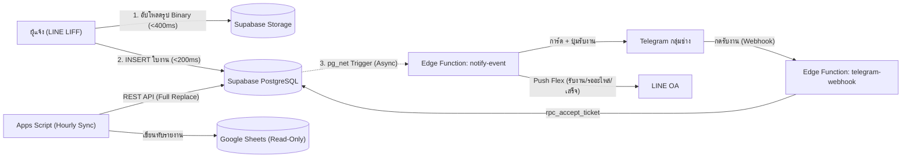

# e-MMS — e-MaintenanceManagementSystem
### ระบบบริหารจัดการงานซ่อมบำรุงออนไลน์ ผ่าน LINE OA (สถาปัตยกรรม Supabase Sub-Second • งบประมาณ 0 บาท)

> [!IMPORTANT]
> **อ่านไฟล์นี้ให้จบก่อนลงมือทำงานทุกครั้ง** (ทั้งคนและ AI agent ในแชทใหม่)
> ไฟล์นี้คือ "สมุดบันทึกโครงการ" — ทุกครั้งที่ทำงานเสร็จ ให้อัปเดตหัวข้อ
> [สถานะปัจจุบัน](#5-สถานะปัจจุบัน-current-status) และ [บันทึกการเปลี่ยนแปลง](#12-บันทึกการเปลี่ยนแปลง-changelog) ด้วยเสมอ

**อัปเดตล่าสุด:** 1 พ.ย. 2569 (2026-11-01)

---

## สารบัญ
1. [โครงการนี้คืออะไร](#1-โครงการนี้คืออะไร)
2. [เทคโนโลยีที่ใช้](#2-เทคโนโลยีที่ใช้-tech-stack)
3. [ข้อมูลระบบจริง (IDs / URLs)](#3-ข้อมูลระบบจริง-ids--urls)
4. [โครงสร้างไฟล์](#4-โครงสร้างไฟล์)
5. [สถานะปัจจุบัน](#5-สถานะปัจจุบัน-current-status)
6. [มติการออกแบบ 20 ข้อ (ห้ามเปลี่ยนโดยไม่ถามเจ้าของ)](#6-มติการออกแบบ-20-ข้อ)
7. [ฐานข้อมูล 15 ตาราง (Supabase PostgreSQL & Google Sheets)](#7-ฐานข้อมูล-15-ตาราง)
8. [Workflow ของระบบ](#8-workflow-ของระบบ)
9. [API Actions & RPC](#9-api-actions--rpc)
10. [วิธีพัฒนาและ Deploy](#10-วิธีพัฒนาและ-deploy)
11. [ข้อควรระวัง / Gotchas](#11-ข้อควรระวัง--gotchas)
12. [บันทึกการเปลี่ยนแปลง](#12-บันทึกการเปลี่ยนแปลง-changelog)
13. [งานที่เหลือ / ไอเดียเฟสถัดไป](#13-งานที่เหลือ--ไอเดียเฟสถัดไป)

---

## 1. โครงการนี้คืออะไร

ระบบแจ้งซ่อมภายในองค์กรของ **สถาบันพัฒนาการชลประทาน / วิทยาลัยการชลประทาน** สำหรับเจ้าหน้าที่ อาจารย์ แม่บ้าน/รปภ. และนักศึกษา

- **ผู้แจ้ง** ใช้งานผ่าน **LINE OA** (เปิดหน้าเว็บ LIFF จาก Rich Menu) → แจ้งซ่อมพร้อมรูป (ตอบสนองเร็ว **< 1 วินาที / Sub-second**) → รับแจ้งเตือนสถานะทาง LINE
- **ทีมช่าง** รับแจ้งเตือนงานใหม่ใน **กลุ่ม Telegram** แบบ Decoupled ทันที → กดปุ่ม "รับงาน" → อัปเดต/ปิดงานผ่านหน้าเว็บ LIFF เดียวกัน
- **Admin & ผู้บริหาร** ดู Dashboard สถิติตามปีงบประมาณในเว็บ LIFF, จัดการข้อมูลผ่าน Supabase Studio (Spreadsheet UI) และดูรายงานสรุปผ่าน **Google Sheets (Read-Only Consumer Sync ตลอด 24/7)**

**ที่มาและสถิติจริงจากระบบเดิม (1 ธ.ค. 2567 – 29 ต.ค. 2569 / ~23 เดือน):**
- ระบบเดิมมีใบงานทั้งหมด **630 รายการ** และรูปภาพที่แนบทั้งหมด **851 ภาพ** ใช้พื้นที่เก็บรูปจริงรวมเพียง **89.9 MB (~100 MB)** (เฉลี่ย **~105.6 KB/ภาพ** หรือใช้พื้นที่เพียง **~47 MB/ปี**)
- **ตัดสินใจเริ่มฐานข้อมูลใหม่ทั้งหมดบน Supabase (ไม่ย้ายข้อมูลเก่า)** เพื่อแก้ปัญหาคอขวด Latency 5–10 วินาทีของ Apps Script Web App ให้ลดลงเหลือ **< 1–2 วินาที (Sub-second)**
- ด้วยอัตราการใช้พื้นที่รูปภาพจริง (~47 MB/ปี) โควต้าฟรี **1 GB (1,024 MB)** บน **Supabase Storage** จะรองรับรูปภาพได้ถึง **~9,500 ภาพ (ใช้งานได้ยาวนาน ~20 ปีในโควต้าฟรี 100%)**

**เป้าหมายการใช้งาน:** 1–2 งาน/วัน, ผู้ใช้พร้อมกัน 3–4 คน → อยู่ในโควต้าฟรี 100% (งบประมาณ 0 บาท/ปี ภายใต้กรอบไม่เกิน 2,000 บาท/ปี)

**ทีมช่าง (จากระบบเดิม):** สุรชาติ, ทิตติพงค์, พิชัย, นพพล, พีระชัย

---

## 2. เทคโนโลยีที่ใช้ (Tech Stack)

| ส่วน | เทคโนโลยี | หมายเหตุ |
|---|---|---|
| Frontend | HTML + Vanilla JS + **Tailwind CSS (CDN)** + **Chart.js** + **LINE LIFF SDK v2** + **`@supabase/supabase-js` v2** | ไม่มี build step — เชื่อมต่อ Supabase ตรงแบบ Asynchronous (< 1 วินาที) พร้อม Fallback ไป GAS อัตโนมัติ |
| Hosting หน้าเว็บ | **GitHub Pages** | repo `TopseasoN/e-mms`, branch `main`, root |
| Primary Database | **Supabase (Managed PostgreSQL)** (Region: Singapore) | 15 ตาราง + RLS + Atomic Trigger ออกรหัส `JTR-YYMM-NNN` + `pg_cron` 08:00 น. (โควต้าฟรี 500 MB) |
| เก็บรูปภาพ | **Supabase Storage** (`ticket-attachments`) | อัปโหลด Binary ตรงจากเบราว์เซอร์ (< 500ms) โควต้าฟรี 1 GB (รองรับ ~9,500 ภาพ / ~20 ปีจากสถิติจริง 851 ภาพ = 89.9 MB) |
| Decoupled Serverless | **Supabase Edge Functions** (Deno) | `notify-event` (ส่งการ์ด Telegram + LINE Push แบบไม่บล็อกหน้าบ้าน), `telegram-webhook` (รับปุ่มกดรับงาน), `line-webhook` (ตอบ Flex ฟรี) |
| Reporting Sync (24/7) | **Google Sheets + Google Apps Script (`SupabaseSync.js`)** | ทำหน้าที่ Read-Only Consumer ดึงข้อมูลจาก Supabase REST API แบบ Full Replace ทุก 1 ชม. (ช่วย Keep-Alive ป้องกัน Supabase Pause หลัง 7 วัน) + ปุ่มกด Refresh บนเมนูชีต |
| แจ้งเตือนผู้แจ้ง | **LINE Messaging API** | Reply (ฟรี) + Push (≤300/เดือน) แบบ Flex Message |
| แจ้งเตือนช่าง | **Telegram Bot API** | Inline Button "รับงาน" + สรุปงานค้าง 08:00 น. (จ–ศ) |
| Deploy Apps Script | **clasp** (`@google/clasp`) | `rootDir: apps-script` |

---

## 3. ข้อมูลระบบจริง (IDs / URLs)

| รายการ | ค่า |
|---|---|
| Apps Script **Script ID** | `1_gCIrGV1c5HL0lzXUSTsJl8fpmTvaj9jDNupNivhT_d4TlEIlrsjK87f` |
| Web App **Deployment ID** (ใช้ ID นี้ตลอด ห้ามสร้างใหม่) | `AKfycbxg71MIIDI5RtmBiM-dl1NZLjNFnbc6rWO46OyZ9GdVam39udnPFcd0zqQzezpxNUk` |
| **Web App / Webhook URL** (Fallback & Sheets Sync) | `https://script.google.com/macros/s/AKfycbxg71MIIDI5RtmBiM-dl1NZLjNFnbc6rWO46OyZ9GdVam39udnPFcd0zqQzezpxNUk/exec` |
| Deployment version ล่าสุด | `@6` |
| GitHub repo | https://github.com/TopseasoN/e-mms |
| GitHub Pages (หน้าเว็บ LIFF Endpoint) | https://topseason.github.io/e-mms/web/ |
| LINE Login Channel ID | `2012286335` |
| LIFF ID | อยู่ในตาราง `Sys_Config` → `LIFF_ID` (รูปแบบ `2012286335-xxxxxxxx`) |
| Google Drive โฟลเดอร์รูป (สำรอง) | `1VSmtUyahQ3XTytpap1IROfKO_jTTP-ez` |
| Telegram Chat ID กลุ่มช่าง | อยู่ในตาราง `Sys_Config` → `TELEGRAM_CHAT_ID` |
| Admin เริ่มต้น | username `thanawat.b` (USER0001, นายธนาวัฒน์ บุตรศรี) |

**Secrets** (ห้ามใส่ในโค้ดหรือในชีต):
- ใน **Supabase Edge Function Secrets**: `TELEGRAM_BOT_TOKEN`, `LINE_CHANNEL_ACCESS_TOKEN`
- ใน **Apps Script → Project Settings → Script Properties**:
  - `SUPABASE_URL`, `SUPABASE_KEY` (สำหรับดึงข้อมูลมารายงานใน Google Sheets)
  - `LINE_CHANNEL_ACCESS_TOKEN`, `LINE_LOGIN_CHANNEL_ID`, `TELEGRAM_BOT_TOKEN`

---

## 4. โครงสร้างไฟล์

```text
e-MMS_ระบบบริหารจัดการงานซ่อมบำรุงออนไลน์/
├── README.md                ← ไฟล์นี้ (อ่านก่อนเสมอ)
├── AGENTS.md                ← กฎสำหรับ AI agent (บังคับอ่าน README ก่อน)
├── index.html               ← redirect หน้า root ของ GitHub Pages → ./web/
├── .clasp.json              ← scriptId + rootDir: apps-script
├── .gitignore               ← ซ่อน Databases/ (ข้อมูลส่วนบุคคล) ไม่ขึ้น GitHub
│
├── supabase/                ← ★ โครงสร้างฐานข้อมูลหลัก PostgreSQL & Edge Functions
│   ├── migrations/
│   │   └── 20261101000000_init_emms_schema.sql ← DDL 15 ตาราง + Seed + Atomic JTR Trigger + Storage + RLS + RPC
│   └── functions/
│       ├── _shared/emms-helpers.ts             ← Helper แปลงข้อมูลใบงาน, การ์ด Telegram, LINE Flex
│       ├── notify-event/index.ts               ← Decoupled Webhook ส่งการ์ด Telegram + LINE Push + สรุปเช้า 08:00
│       ├── telegram-webhook/index.ts           ← รับปุ่มกด "รับงาน" และคำสั่ง /link /pending /chatid
│       └── line-webhook/index.ts               ← รับข้อความแจ้งซ่อม ตอบกลับด้วย Flex Message ฟรี (replyToken)
│
├── apps-script/             ← Google Sheets Reporting Sync & Fallback API (push ด้วย clasp)
│   ├── appsscript.json      ← V8, Asia/Bangkok, webapp: USER_DEPLOYING + ANYONE_ANONYMOUS
│   ├── SupabaseSync.js      ← ★ ดึงข้อมูลจาก Supabase REST API ลงชีต (Full Replace ทุก 1 ชม. + ปุ่มเมนูรีเฟรช)
│   ├── Code.js              ← doGet/doPost router, routeApiAction_, initializeSystemAll()
│   ├── SetupDatabase.js     ← ★ แหล่งความจริงเดียวของ schema 15 ตาราง (DB_SCHEMA) + seed + setupDatabase()
│   ├── DbUtils.js           ← readTable_/appendRowObj_/updateRowById_, nextId_, uploadBase64ToDrive_
│   ├── AuthService.js       ← verify LINE idToken, auto-login, bindLine
│   ├── TicketService.js     ← create/cancel/accept/updateStatus, duplicate check, Trans_Assignments
│   ├── LineService.js       ← Flex Message, Reply (ฟรี), Push + quota counter
│   ├── TelegramService.js   ← การ์ดงาน, ปุ่มรับงาน, /link /pending /chatid, daily summary
│   └── AdminService.js      ← จัดการผู้ใช้, reset LINE, dashboard ปีงบประมาณ + สถิติช่าง
│
├── web/                     ← Frontend (GitHub Pages)
│   ├── index.html           ← SPA ทุกหน้า + โหลด @supabase/supabase-js v2
│   ├── app.js               ← เชื่อมต่อ Direct Supabase Mode (< 1s) + Fallback GAS API อัตโนมัติ
│   └── config.js            ← SUPABASE_URL, SUPABASE_ANON_KEY, API_URL, LIFF_ID
│
├── docs/
│   ├── BLUEPRINT.md         ← สถาปัตยกรรม, มติ 20 ข้อ, วิเคราะห์โควต้าจากสถิติจริง (851 ภาพ = 89.9 MB)
│   ├── DATABASE.md          ← Data dictionary + ER diagram (สร้างอัตโนมัติ ห้ามแก้มือ)
│   └── SETUP_GUIDE.md       ← คู่มือตั้งค่าทีละคลิก: Sheets, Drive, Telegram, LINE OA/LIFF, Rich Menu, Supabase
│
├── tools/
│   └── export_schema.js     ← node tools/export_schema.js → สร้าง CSV + docs/DATABASE.md จาก DB_SCHEMA
│
└── Databases/               ← (gitignored) ข้อมูลระบบเก่า + CSV schema v1
```

---

## 5. สถานะปัจจุบัน (Current Status)

| เฟส | งาน | สถานะ |
|---|---|---|
| 1 | สัมภาษณ์ความต้องการ (`/grill-me` 20 ข้อ) + ออกแบบฐานข้อมูล 15 ตาราง | ✅ เสร็จ |
| 2 | Backend Google Apps Script + ระบบ Sync รายงานจาก Supabase (`SupabaseSync.js`) + Deploy `@6` | ✅ เสร็จ |
| 3 | Frontend LIFF Web App (`web/`) รองรับ Direct Supabase Client + Storage (< 1 วินาที) | ✅ เสร็จ |
| 4 | โครงสร้าง Supabase SQL Migration + Edge Functions (`notify-event`, `telegram-webhook`, `line-webhook`) | ✅ เสร็จ |
| 5 | คู่มือตั้งค่า (`SETUP_GUIDE.md`) รวม Rich Menu และการตั้งค่า Supabase | ✅ เสร็จ |
| 6 | **ตั้งค่าโปรเจกต์ Supabase จริง + ทดสอบใช้งานจริง (UAT)** | 🟡 **กำลังทำ** |

**สิ่งที่ต้องดำเนินการต่อ (Action Items สำหรับเจ้าของ):**
- [ ] รัน `git push` เพื่ออัปเดตโค้ดล่าสุดขึ้น GitHub Pages
- [ ] สร้างโปรเจกต์บน Supabase (Region: Singapore) แล้วรันไฟล์ [`supabase/migrations/20261101000000_init_emms_schema.sql`](supabase/migrations/20261101000000_init_emms_schema.sql) ใน SQL Editor (ดูขั้นตอนใน [docs/SETUP_GUIDE.md](docs/SETUP_GUIDE.md) ขั้นตอนที่ 8)
- [ ] นำค่า `SUPABASE_URL` และ `SUPABASE_ANON_KEY` มาใส่ใน [`web/config.js`](web/config.js) และใส่ใน Script Properties ของ Apps Script เพื่อเปิดใช้งาน Auto-Sync ลง Google Sheets ทุก 1 ชั่วโมง

---

## 6. มติการออกแบบ 20 ข้อ

> ได้จากการสัมภาษณ์เจ้าของ (`/grill-me`) — **ห้ามเปลี่ยนโดยไม่ถามเจ้าของก่อน** รายละเอียดเต็มดู [docs/BLUEPRINT.md](docs/BLUEPRINT.md)

| # | หัวข้อ | มติ |
|---|---|---|
| 1 | สถาปัตยกรรม | **LINE LIFF (GitHub Pages)** เชื่อมต่อตรงกับ **Supabase (PostgreSQL + Storage + Edge Functions)** ตอบสนอง **< 1–2 วินาที (Sub-second)** และมี **Google Sheets** เป็น Read-Only Consumer Sync ตลอด 24/7 |
| 2 | Login | ผูกบัญชีครั้งแรกด้วย username/password ที่ Admin สร้าง (`rpc_bind_line_account`) → บันทึก `line_user_id` → ครั้งต่อไป auto-login |
| 3 | Roles | 3 บทบาทในตาราง `Master_Users` เดียว: `user` / `technician` / `admin` |
| 4 | แจ้งเตือนช่าง | **Decoupled Alert**: Database Trigger (`pg_net`) ยิงเข้า Edge Function `notify-event` ส่งการ์ดเข้า Telegram Group + Inline Button (รับงาน / เปิดดู) โดยไม่รบกวนเวลาตอบสนองหน้าบ้าน |
| 5 | สถานะ | `PENDING` → `ACCEPTED` → `IN_PROGRESS` ⇄ `ON_HOLD` → `COMPLETED` / `CANNOT_REPAIR`; `CANCELLED` (ผู้แจ้งยกเลิกได้เฉพาะตอน PENDING) |
| 6 | มอบหมายช่าง | ทีมช่างซ่อมร่วมกัน: บันทึกคนกดรับงานคนแรก (`rpc_accept_ticket`, วัด response time) + ตอนปิดงานติ๊ก checkbox ช่างร่วมงานทุกคน → `Trans_Assignments` (สถิติรายคน) |
| 7 | สถานที่ | `Master_Buildings` → `Master_Locations` (dropdown) + ห้องพิมพ์เอง (autocomplete จาก `Master_Rooms` + ห้องที่เคยแจ้ง) |
| 8 | หมวดงาน | ผู้แจ้งเลือกหมวดหลัก+ย่อย (บังคับ) → ช่างแก้หมวดจริงได้ตอนปิดงาน (`cat_id_reported` / `cat_id_actual`) |
| 9 | ความเร่งด่วน | **ไม่มี** — ทำตามลำดับ ช่างตัดสินใจเอง |
| 10 | รูปภาพ | ผู้แจ้ง 1–3 รูป (บังคับ ≥1) + ช่างรูปหลังซ่อม 1–3 รูป (บังคับตอนปิด) ย่อรูปในเบราว์เซอร์แล้วอัปโหลด Binary ตรงเข้า **Supabase Storage** Bucket `ticket-attachments` *(จากสถิติจริง 851 ภาพใน ~2 ปี ใช้เพียง 89.9 MB โควต้าฟรี 1 GB ใช้ได้ ~20 ปี)* |
| 11 | แจ้งเตือนผู้แจ้ง | รับเรื่อง = Reply ฟรี (`line-webhook`); Push เฉพาะ `ACCEPTED`, `ON_HOLD`, `COMPLETED`/`CANNOT_REPAIR` + ตัวนับโควต้า 300/เดือน |
| 12 | ประเมินความพึงพอใจ | **ไม่มี** |
| 13 | รหัสงาน | `JTR-YYMM-NNN` (YY = ปี พ.ศ. 2 หลัก, รันใหม่ทุกเดือน) สร้างอัตโนมัติด้วย PostgreSQL Trigger (`BEFORE INSERT`) + รายงานตามปีงบประมาณ (1 ต.ค.–30 ก.ย.) |
| 14 | ข้อมูลเก่า 630 งาน | **ไม่ย้าย** เริ่มใหม่หมด |
| 15 | วัสดุ | ข้อความง่าย ๆ: `cause_solution` + `materials_used` — **ไม่ทำคลังวัสดุ** |
| 16 | Admin & รายงาน | จัดการผู้ใช้และ Master Data ผ่านหน้า Admin ในเว็บ + **Supabase Studio (Table Editor)** ส่วน **Google Sheets** เป็น Read-Only Viewer ซิงค์แบบ Full Replace ทุก 1 ชม. (`SupabaseSync.js`) + ปุ่มกด Manual Refresh |
| 17 | บัญชีผู้ใช้ | นักศึกษา: username = รหัสนักศึกษา, password = วดป.เกิด พ.ศ. `ddmmyyyy` (เหมือน WiFi) — **plaintext, ไม่ hash, ไม่บังคับเปลี่ยนรหัส** (เจ้าของเลือกเอง) |
| 18 | หน้าจอช่าง | เว็บ LIFF เดียวกัน เมนูตาม role; Telegram ใช้แจ้งเตือน + กดรับงาน (`telegram-webhook` ผูก `telegram_user_id`) |
| 19 | เตือนงานค้าง | สรุปงานค้าง Telegram ทุกเช้า 08:00 จ–ศ ผ่าน **Supabase `pg_cron` + `pg_net`** |
| 20 | การมองเห็น | ผู้แจ้งเห็นเฉพาะงานตัวเอง + เตือน "มีคนแจ้งแล้ว" ถ้ามีงานเปิดอยู่ในอาคาร/ชั้น/ห้องเดียวกัน (ไม่แสดงชื่อผู้แจ้งเดิม) |

---

## 7. ฐานข้อมูล 15 ตาราง

โครงสร้างทั้ง 15 ตารางตรงกัน 100% ระหว่าง **Supabase PostgreSQL** ([supabase/migrations/20261101000000_init_emms_schema.sql](supabase/migrations/20261101000000_init_emms_schema.sql)) และ **Google Sheets** ([apps-script/SetupDatabase.js](apps-script/SetupDatabase.js)) — รายละเอียดคอลัมน์ดู [docs/DATABASE.md](docs/DATABASE.md)

| กลุ่ม | ตาราง / ชีต | หน้าที่ | Seed |
|---|---|---|---|
| Master | `Master_Users` | ผู้ใช้ทุก role, `line_user_id`, `telegram_user_id` | 6 (admin + ช่าง 5) |
| | `Master_Departments` | สังกัด → ส่วนงาน (`DEP01`–`DEP10`) | 10 |
| | `Master_Buildings` | อาคาร (`BLD01`–`BLD17`) | 17 |
| | `Master_Locations` | ชั้น/บริเวณ (`LOC001`–`LOC045`) | 45 |
| | `Master_Rooms` | ห้องสำหรับ autocomplete | 2 |
| | `Master_Categories` | หมวดหลัก → ย่อย (`CAT001`–`CAT024`) | 24 |
| | `Master_Statuses` | 7 สถานะ + สี + `notify_requester` | 7 |
| Transaction | `Trans_JobTickets` | ใบงาน (27 คอลัมน์, snapshot ข้อมูลผู้แจ้ง) | 0 |
| | `Trans_Assignments` | ช่าง 1 คน / 1 งาน / 1 แถว | 0 |
| | `Trans_Attachments` | รูป `BEFORE` / `AFTER` + URL จาก Supabase Storage | 0 |
| | `Trans_StatusLogs` | ประวัติเปลี่ยนสถานะทุกครั้ง | 0 |
| System | `Sys_Config` | ค่าตั้งค่า key/value (ไม่ใช่ secret) | 22 |
| | `Sys_Counters` | เลขรัน (`JTR-6911`, `ASG`, `ATT`, `LOG`, `NTF`, `AUD`, `USER`) | 1 |
| | `Sys_NotificationLogs` | log การแจ้งเตือน + นับโควต้า LINE Push | 0 |
| | `Sys_AuditLogs` | login, ผูก LINE/Telegram, แก้ผู้ใช้ | 0 |

---

## 8. Workflow ของระบบ



---

## 9. API Actions & RPC

หน้าเว็บ `web/app.js` เรียกผ่าน `callApi(action, payload)` ซึ่งจะทำงานผ่าน **Supabase Direct Mode** ทันทีเมื่อตั้งค่า `SUPABASE_URL` (หรือสลับไปใช้ Apps Script Web App อัตโนมัติหากยังไม่ได้ตั้งค่า):

| Action | สิทธิ์ | กลไกใน Supabase Mode |
|---|---|---|
| `getSession` | ทุกคน | Query `Master_Users` + Master tables แบบ Parallel (`Promise.all`) |
| `bindLine` | ทุกคน | เรียก PostgreSQL RPC `rpc_bind_line_account` |
| `checkDuplicate` | ผูกแล้ว | Query `Trans_JobTickets` สถานะเปิดในจุดเดียวกัน |
| `createTicket` | ผูกแล้ว | Insert `Trans_JobTickets` (Trigger ออกรหัส `JTR-YYMM-NNN`) + Upload รูปเข้า Storage Bucket `ticket-attachments` |
| `listMyTickets` / `cancelTicket` | ผูกแล้ว | Query / Update `Trans_JobTickets` เฉพาะของตัวเอง |
| `listQueueTickets` / `acceptTicket` / `updateTicketStatus` | technician, admin | Query คิวช่าง / เรียก RPC `rpc_accept_ticket` / อัปโหลดรูปหลังซ่อม + บันทึก `Trans_Assignments` |
| `adminListUsers` / `adminSaveUser` / `adminResetLine` | admin | จัดการตาราง `Master_Users` |
| `adminDashboard` / `adminSendPendingSummary` | admin | คำนวณสถิติปีงบประมาณ / เรียก Edge Function `notify-event` |

---

## 10. วิธีพัฒนาและ Deploy

### 1. Supabase (Database & Edge Functions)
```zsh
# รัน SQL Migration ใน Supabase SQL Editor จากไฟล์:
# supabase/migrations/20261101000000_init_emms_schema.sql

# หรือใช้ Supabase CLI deploy Edge Functions:
npx supabase functions deploy notify-event --no-verify-jwt
npx supabase functions deploy telegram-webhook --no-verify-jwt
npx supabase functions deploy line-webhook --no-verify-jwt
```

### 2. Google Apps Script (Google Sheets Sync & Fallback API)
```zsh
for f in apps-script/*.js; do node --check "$f"; done      # ตรวจ syntax
clasp push --force                                          # อัปโหลด
clasp deploy -i AKfycbxg71MIIDI5RtmBiM-dl1NZLjNFnbc6rWO46OyZ9GdVam39udnPFcd0zqQzezpxNUk -d "e-MMS API, Webhook & Supabase Sync"
```

### 3. Frontend (GitHub Pages)
```zsh
node --check web/app.js && node --check web/config.js
git add -A && git commit -m "..." && git push
```

---

## 11. ข้อควรระวัง / Gotchas

- **ห้ามใส่ Token หรือ Service Role Key ในโค้ดหรือในชีต** — เก็บใน Supabase Secrets หรือ Apps Script `Script Properties` เท่านั้น
- **Supabase Free Tier Auto-Pause (7 วัน):** สคริปต์ `setupSupabaseHourlySyncTrigger()` ใน `apps-script/SupabaseSync.js` จะดึงข้อมูลทุก 1 ชั่วโมง ซึ่งทำหน้าที่ Keep-Alive ป้องกันไม่ให้โปรเจกต์ Supabase ถูก Pause อัตโนมัติ
- **Apps Script ทุกไฟล์อยู่ global scope เดียวกัน** — ชื่อฟังก์ชันห้ามซ้ำข้ามไฟล์
- เวลา/วันที่ทั้งหมดใช้ `Asia/Bangkok` และแสดงปี พ.ศ.

---

## 12. บันทึกการเปลี่ยนแปลง (Changelog)

| วันที่ | สิ่งที่ทำ |
|---|---|
| 2569-10-29 | วิเคราะห์ข้อมูลเก่า (630 งาน, 44 สถานที่, ช่าง 5 คน, 4 สถานะ) · สัมภาษณ์ `/grill-me` 20 ข้อ · ออกแบบ schema 15 ชีต · สร้าง `SetupDatabase.js`, `export_schema.js`, CSV, `DATABASE.md`, `BLUEPRINT.md`, `SETUP_GUIDE.md` |
| 2569-10-30 | เจ้าของตั้งค่า LINE OA/LIFF/Telegram/Script Properties · เขียน backend ครบ 8 ไฟล์ + clasp push + deploy · เขียน frontend `web/` · ขึ้น GitHub Pages (`topseason.github.io/e-mms`) · เพิ่มคู่มือ Rich Menu + `?tab=` · แก้ bug Drive folder ID มี `?lfhs=2` (Deploy `@5`) |
| 2569-11-01 | สร้าง `README.md` + `AGENTS.md` · **สัมภาษณ์ `/grill-me` รอบที่ 2 เพื่อย้ายสถาปัตยกรรมหลักสู่ Supabase (Sub-second Latency < 1s)** · วิเคราะห์สถิติรูปภาพจริงจากระบบเดิม (851 ภาพ ตั้งแต่ 1/12/2567 – 29/10/2569 ใช้พื้นที่เพียง 89.9 MB → โควต้าฟรี 1 GB บน Supabase Storage ใช้ได้ ~20 ปี) · สร้าง `supabase/migrations/20261101000000_init_emms_schema.sql`, Edge Functions 3 ตัว (`notify-event`, `telegram-webhook`, `line-webhook`), สร้าง `apps-script/SupabaseSync.js` สำหรับซิงค์ข้อมูลลง Google Sheets แบบ Read-Only ทุก 1 ชม. + ปุ่มเมนูรีเฟรช · อัปเกรด `web/app.js` และ `web/config.js` ให้เชื่อมต่อ Supabase ตรง · Deploy Apps Script เวอร์ชัน `@6` |

---

## 13. งานที่เหลือ / ไอเดียเฟสถัดไป

**ต้องทำ:**
- [x] `git push` โค้ดทั้งหมดขึ้น GitHub (`main`)
- [x] สร้างโปรเจกต์ Supabase (Region: Singapore) และรัน `supabase/migrations/20261101000000_init_emms_schema.sql`
- [x] กรอก `SUPABASE_URL` และ `SUPABASE_ANON_KEY` ใน `web/config.js` และใน Apps Script `Script Properties`
- [x] ทดสอบการซิงค์ข้อมูลจาก Supabase ลง Google Sheets สำเร็จ (8.06 วินาที)
- [ ] เปิดใช้งาน Auto-Sync ทุก 1 ชั่วโมงจากเมนู `⚡ e-MMS (Supabase Sync)` บน Google Sheets (Keep-Alive)
- [ ] Deploy Supabase Edge Functions สำหรับส่งแจ้งเตือน Telegram / LINE
- [ ] ทดสอบ UAT ครบวงจร (แจ้งซ่อม < 1 วินาที, แจ้งเตือน Telegram, กดรับงาน, ปิดงาน, ซิงค์รายงานลง Google Sheets)
