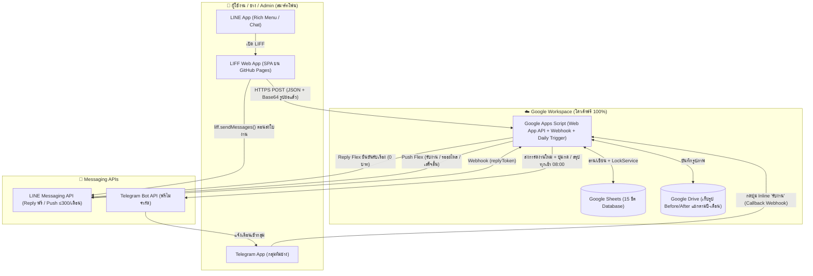
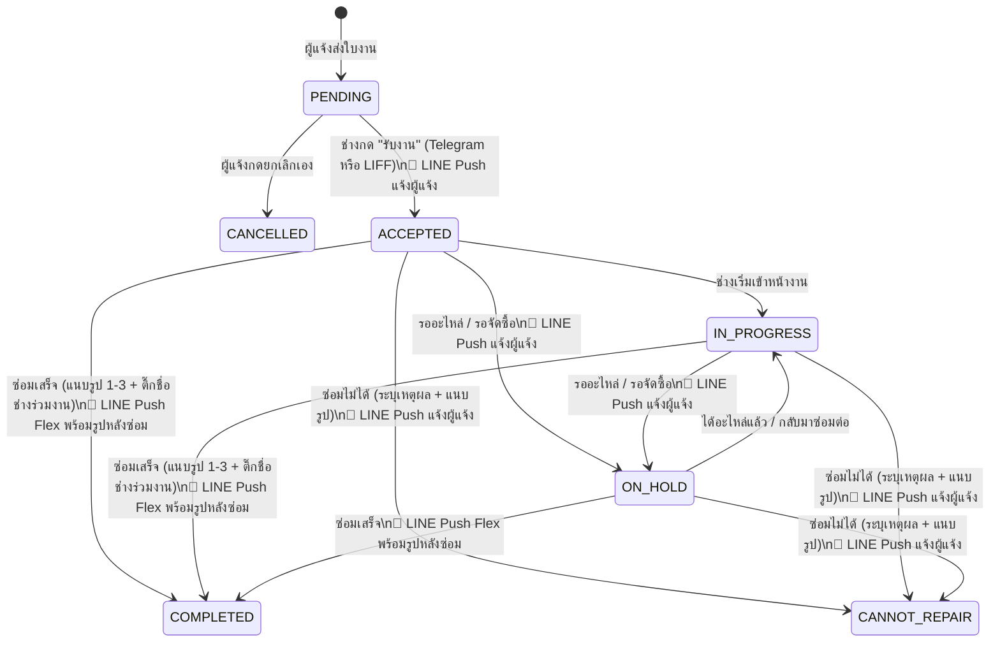

# Blueprint & แผนพัฒนาระบบ e-MMS (งบประมาณ 0 บาท)
**ชื่อเต็ม:** `e-MaintenanceManagementSystem_e-MMS_ระบบบริหารจัดการงานซ่อมบำรุงออนไลน์`  
**หน่วยงาน:** สถาบันพัฒนาการชลประทาน / วิทยาลัยการชลประทาน

---

## 1. สรุปมติจากการสัมภาษณ์ (20 หัวข้อ)

| # | หัวข้อ | มติที่ตกลง |
|---|---|---|
| 1 | สถาปัตยกรรมหลัก | **LINE LIFF (GitHub Pages)** ↔ **Supabase (Managed PostgreSQL + Storage + Edge Functions Region Singapore)** ตอบสนองระดับ **Sub-second (< 1 วินาที)** + **Google Sheets (Read-Only Consumer Sync ทุก 1 ชม.)** |
| 2 | ระบบ Login | ผูกบัญชีครั้งแรกด้วย `username` / `password` ที่ Admin สร้างไว้ (ผ่าน RPC `rpc_bind_line_account`) → บันทึก `line_user_id` อัตโนมัติ → ครั้งต่อไปเข้าใช้งานผ่าน LINE ได้ทันที (Auto-login) |
| 3 | บทบาทผู้ใช้ (Roles) | 3 บทบาทในตาราง [`Master_Users`](file:///Users/mek/e-MMS_%E0%B8%A3%E0%B8%B0%E0%B8%9A%E0%B8%9A%E0%B8%9A%E0%B8%A3%E0%B8%B4%E0%B8%AB%E0%B8%B2%E0%B8%A3%E0%B8%88%E0%B8%B1%E0%B8%94%E0%B8%81%E0%B8%B2%E0%B8%A3%E0%B8%87%E0%B8%B2%E0%B8%99%E0%B8%8B%E0%B9%88%E0%B8%AD%E0%B8%A1%E0%B8%9A%E0%B8%B3%E0%B8%A3%E0%B8%B8%E0%B8%87%E0%B8%AD%E0%B8%AD%E0%B8%99%E0%B9%84%E0%B8%A5%E0%B8%99%E0%B9%8C/Databases/e-MMS_v1/e-MMS_v1%20-%20Master_Users.csv) เดียว: `user` (ผู้แจ้ง), `technician` (ทีมช่าง), `admin` (ผู้ดูแลระบบ) |
| 4 | แจ้งเตือนทีมช่าง | **Decoupled Notification**: Database Trigger (`pg_net`) ยิงเข้า Supabase Edge Function `notify-event` ส่งเข้า **Telegram Group** + Inline Buttons (`รับงาน` / `เปิดดูใน LINE`) โดยไม่บล็อกหน้าเว็บผู้แจ้ง |
| 5 | สถานะงาน (Workflow) | 7 สถานะ: `PENDING` (รอตรวจสอบ) → `ACCEPTED` (รับงานแล้ว) → `IN_PROGRESS` (กำลังดำเนินการ) ⇄ `ON_HOLD` (รออะไหล่/จัดซื้อ) → `COMPLETED` (เสร็จสิ้น) / `CANNOT_REPAIR` (ไม่สามารถซ่อมได้) / `CANCELLED` (ยกเลิกโดยผู้แจ้งเฉพาะตอน `PENDING`) |
| 6 | การทำงานร่วมกันและสถิติช่าง | ทีมช่างเข้าซ่อมร่วมกัน บันทึกคนกด "รับงาน" คนแรกเพื่อวัดเวลาตอบสนอง (Response Time) และตอนปิดงาน ช่างติ๊กเลือก **Checkbox รายชื่อผู้ร่วมงานทุกคน** ลงตาราง [`Trans_Assignments`](file:///Users/mek/e-MMS_%E0%B8%A3%E0%B8%B0%E0%B8%9A%E0%B8%9A%E0%B8%9A%E0%B8%A3%E0%B8%B4%E0%B8%AB%E0%B8%B2%E0%B8%A3%E0%B8%88%E0%B8%B1%E0%B8%94%E0%B8%81%E0%B8%B2%E0%B8%A3%E0%B8%87%E0%B8%B2%E0%B8%99%E0%B8%8B%E0%B9%88%E0%B8%AD%E0%B8%A1%E0%B8%9A%E0%B8%B3%E0%B8%A3%E0%B8%B8%E0%B8%87%E0%B8%AD%E0%B8%AD%E0%B8%99%E0%B9%84%E0%B8%A5%E0%B8%99%E0%B9%8C/Databases/e-MMS_v1/e-MMS_v1%20-%20Trans_Assignments.csv) เพื่อสรุปสถิติภาระงานรายบุคคล |
| 7 | โครงสร้างสถานที่ | แยก [`Master_Buildings`](file:///Users/mek/e-MMS_%E0%B8%A3%E0%B8%B0%E0%B8%9A%E0%B8%9A%E0%B8%9A%E0%B8%A3%E0%B8%B4%E0%B8%AB%E0%B8%B2%E0%B8%A3%E0%B8%88%E0%B8%B1%E0%B8%94%E0%B8%81%E0%B8%B2%E0%B8%A3%E0%B8%87%E0%B8%B2%E0%B8%99%E0%B8%8B%E0%B9%88%E0%B8%AD%E0%B8%A1%E0%B8%9A%E0%B8%B3%E0%B8%A3%E0%B8%B8%E0%B8%87%E0%B8%AD%E0%B8%AD%E0%B8%99%E0%B9%84%E0%B8%A5%E0%B8%99%E0%B9%8C/Databases/e-MMS_v1/e-MMS_v1%20-%20Master_Buildings.csv) (อาคาร) → [`Master_Locations`](file:///Users/mek/e-MMS_%E0%B8%A3%E0%B8%B0%E0%B8%9A%E0%B8%9A%E0%B8%9A%E0%B8%A3%E0%B8%B4%E0%B8%AB%E0%B8%B2%E0%B8%A3%E0%B8%88%E0%B8%B1%E0%B8%94%E0%B8%81%E0%B8%B2%E0%B8%A3%E0%B8%87%E0%B8%B2%E0%B8%99%E0%B8%8B%E0%B9%88%E0%B8%AD%E0%B8%A1%E0%B8%9A%E0%B8%B3%E0%B8%A3%E0%B8%B8%E0%B8%87%E0%B8%AD%E0%B8%AD%E0%B8%99%E0%B9%84%E0%B8%A5%E0%B8%99%E0%B9%8C/Databases/e-MMS_v1/e-MMS_v1%20-%20Master_Locations.csv) (ชั้น/บริเวณ) เลือกแบบ Cascading Dropdown + ช่อง "ห้อง" พิมพ์เองพร้อม Autocomplete จาก [`Master_Rooms`](file:///Users/mek/e-MMS_%E0%B8%A3%E0%B8%B0%E0%B8%9A%E0%B8%9A%E0%B8%9A%E0%B8%A3%E0%B8%B4%E0%B8%AB%E0%B8%B2%E0%B8%A3%E0%B8%88%E0%B8%B1%E0%B8%94%E0%B8%81%E0%B8%B2%E0%B8%A3%E0%B8%87%E0%B8%B2%E0%B8%99%E0%B8%8B%E0%B9%88%E0%B8%AD%E0%B8%A1%E0%B8%9A%E0%B8%B3%E0%B8%A3%E0%B8%B8%E0%B8%87%E0%B8%AD%E0%B8%AD%E0%B8%99%E0%B9%84%E0%B8%A5%E0%B8%99%E0%B9%8C/Databases/e-MMS_v1/e-MMS_v1%20-%20Master_Rooms.csv) และประวัติห้องที่เคยแจ้ง |
| 8 | หมวดงานซ่อม | ผู้แจ้งเลือกหมวดหลัก + หมวดย่อย (บังคับ) บันทึกใน `cat_id_reported` และช่างยืนยัน/แก้ไขหมวดจริงตอนปิดงานใน `cat_id_actual` |
| 9 | ความเร่งด่วน (Priority) | **ไม่มีระดับความเร่งด่วน** — เรียงตามลำดับการแจ้งเข้า ทีมช่างเป็นผู้พิจารณาจัดลำดับหน้างานเอง |
| 10 | รูปภาพประกอบ | ผู้แจ้งแนบรูปก่อนซ่อม **1–3 รูป (บังคับ ≥1)** + ช่างแนบรูปหลังซ่อม **1–3 รูป (บังคับตอนปิดงาน)** ย่อรูปในเบราว์เซอร์แล้วอัปโหลด Binary ตรงเข้า **Supabase Storage** Bucket `ticket-attachments` (< 500ms) *(จากสถิติจริง 1 ธ.ค. 2567 – 29 ต.ค. 2569 มี 851 ภาพ ใช้พื้นที่รวมเพียง 89.9 MB ≈ 105 KB/ภาพ โควต้าฟรี 1 GB รองรับได้ ~20 ปี)* |
| 11 | แจ้งเตือนผู้แจ้ง (LINE OA) | ประหยัดโควต้า: ยืนยันรับเรื่องใช้ `liff.sendMessages` + Reply Token (**ฟรี**) ส่วน LINE Push (โควต้าฟรี 300 ข้อความ/เดือน) ส่งเฉพาะ 3 จุด: `ACCEPTED`, `ON_HOLD`, และ `COMPLETED`/`CANNOT_REPAIR` (Flex Message พร้อมรูปหลังซ่อม) พร้อมตัวนับโควต้าใน [`Sys_NotificationLogs`](file:///Users/mek/e-MMS_%E0%B8%A3%E0%B8%B0%E0%B8%9A%E0%B8%9A%E0%B8%9A%E0%B8%A3%E0%B8%B4%E0%B8%AB%E0%B8%B2%E0%B8%A3%E0%B8%88%E0%B8%B1%E0%B8%94%E0%B8%81%E0%B8%B2%E0%B8%A3%E0%B8%87%E0%B8%B2%E0%B8%99%E0%B8%8B%E0%B9%88%E0%B8%AD%E0%B8%A1%E0%B8%9A%E0%B8%B3%E0%B8%A3%E0%B8%B8%E0%B8%87%E0%B8%AD%E0%B8%AD%E0%B8%99%E0%B9%84%E0%B8%A5%E0%B8%99%E0%B9%8C/Databases/e-MMS_v1/e-MMS_v1%20-%20Sys_NotificationLogs.csv) |
| 12 | ประเมินความพึงพอใจ | **ไม่มี** (ปิดงานจบในขั้นตอนเดียว) |
| 13 | รหัสใบงานและปีรายงาน | รหัส `JTR-YYMM-NNN` ตามปี พ.ศ. สร้างอัตโนมัติระดับฐานข้อมูลด้วย PostgreSQL `BEFORE INSERT` Trigger (`next_jtr_ticket_id`) + รายงานสรุปตาม**ปีงบประมาณ** (1 ต.ค. – 30 ก.ย.) |
| 14 | ข้อมูลระบบเก่า (630 งาน) | **ไม่ย้ายข้อมูลเก่า** — เริ่มต้นฐานข้อมูลใหม่ทั้งหมด |
| 15 | บันทึกผลการซ่อมและวัสดุ | ช่างกรอกข้อความแบบง่ายตอนปิดงาน: `cause_solution` (สาเหตุ/วิธีแก้ไข) + `materials_used` (วัสดุที่ใช้ เช่น หลอด LED 18W x2) ไม่ทำระบบตัดสต็อกคลังวัสดุ |
| 16 | หน้า Admin และรายงาน | หน้า Admin ในเว็บ LIFF + จัดการ Master Data ผ่าน **Supabase Table Editor (Spreadsheet GUI)** ส่วน **Google Sheets** ทำหน้าที่เป็น Read-Only Consumer ดึงข้อมูลผ่าน REST API ทุก 1 ชม. (`apps-script/SupabaseSync.js`) + ปุ่มกด Manual Refresh บนเมนูชีต |
| 17 | การสร้างบัญชีผู้ใช้ | Admin นำเข้ารายชื่อ (ไม่ต้องบังคับเปลี่ยนรหัส, ไม่ต้อง hash) นักศึกษาใช้ **รหัสนักศึกษา = username** และ **วันเดือนปีเกิด พ.ศ. (`ddmmyyyy`) = password** เหมือนรหัส WiFi ปัจจุบัน |
| 18 | ช่องทางใช้งานของช่าง | ใช้เว็บ LIFF เดียวกัน (เมนูเปลี่ยนตาม Role) ส่วน Telegram ใช้รับแจ้งเตือนและกดปุ่ม "รับงาน" ด่วน (ผูก `telegram_user_id` ของช่างแต่ละคนผ่าน Edge Function `telegram-webhook`) |
| 19 | เตือนงานค้างอัตโนมัติ | ใช้ **Supabase `pg_cron` + `pg_net`** ส่ง **สรุปงานค้างทุกเช้า 08:00 น. (จันทร์–ศุกร์)** เข้ากลุ่ม Telegram อัตโนมัติ |
| 20 | สิทธิ์การมองเห็นงาน & กันงานซ้ำ | ผู้แจ้งเห็นเฉพาะงานของตัวเอง แต่ตอนเลือก อาคาร+ชั้น (+ห้อง) ระบบจะตรวจสอบและแจ้งเตือนหากมีงานที่ยังเปิดอยู่ในจุดเดียวกัน (แสดงหมวด/รายละเอียด/สถานะ โดยไม่เปิดเผยชื่อผู้แจ้งเดิม) |

---

## 2. สถาปัตยกรรมระบบ (Zero-Cost Architecture)

### การบริหารโควต้าฟรีให้รองรับ 100% (อ้างอิงสถิติใช้งานจริง)

> **ข้อมูลสถิติจริงจากระบบเดิม (1 ธ.ค. 2567 – 29 ต.ค. 2569 / ~23 เดือน):**
> - งานแจ้งซ่อมทั้งหมด: **630 งาน** (เฉลี่ย ~27 งาน/เดือน หรือ 1–2 งาน/วัน)
> - รูปภาพที่แนบทั้งหมด: **851 ภาพ** ใช้พื้นที่รวมเพียง **89.9 MB (~100 MB)** เฉลี่ย **~105.6 KB/ภาพ** (~47 MB/ปี)

| บริการ | โควต้าฟรี | การใช้งานจริงของระบบ | แนวทางป้องกันโควต้าเต็ม |
|---|---|---|---|
| **Supabase Database (PostgreSQL)** | 500 MB | ~1.5 MB/ปี (~350–500 งาน/ปี) | ใช้งานได้ยาวนาน **> 30 ปี** พร้อม Auto-Sync จาก GAS ทุก 1 ชม. ช่วย Keep-Alive ป้องกันโหมด Pause หลัง 7 วัน |
| **Supabase Storage (รูปภาพ)** | **1 GB (1,024 MB)** | **~47 MB/ปี** (851 ภาพใน ~2 ปี ใช้เพียง 89.9 MB) | รองรับรูปได้ **~9,500 ภาพ (ใช้งานได้นาน ~20 ปี)** โดยหน้าเว็บ LIFF ย่อรูปด้วย Canvas ก่อนอัปโหลด Binary ตรง (< 500ms) |
| **Supabase Edge Functions** | 500,000 ครั้ง/เดือน | ~1,500–3,000 ครั้ง/เดือน | ใช้ไม่ถึง 1% ของโควต้าฟรี (ทำหน้าที่ส่ง Telegram/LINE แบบ Decoupled และรับ Webhook) |
| **LINE OA Push Message** | 300 ข้อความ/เดือน | ~3 Push/งาน × 30 งาน ≈ **90 ข้อความ/เดือน** | 1. ตอนเปิดงานใช้ `liff.sendMessages` + `replyToken` (ฟรี ไม่เสียโควต้า Push) 2. ส่ง Push เฉพาะ `ACCEPTED`, `ON_HOLD`, `COMPLETED`/`CANNOT_REPAIR` 3. นับทุก Push ลง `Sys_NotificationLogs` เตือน Admin ทาง Telegram เมื่อถึง 250 ข้อความ |
| **Telegram Bot API** | ฟรี ไม่จำกัดจำนวนข้อความ | แจ้งงานใหม่ + อัปเดตการ์ดงาน + สรุปงานค้างทุกเช้า | ใช้ `editMessageText` อัปเดตข้อความเดิมในกลุ่มเมื่อสถานะเปลี่ยน ลดข้อความรกในกลุ่ม |
| **Google Sheets + Apps Script** | ฟรี 100% | ซิงค์ข้อมูล Read-Only ทุก 1 ชม. (`syncAllFromSupabase`) | ใช้ Single Batch Write (`setValues`) ใช้เวลาซิงค์เพียง ~1–2 วินาทีต่อรอบ |
| **GitHub Pages** | ฟรี 100 GB/เดือน | หน้าเว็บ Static HTML/CSS/JS | โหลดเร็วและฝังใน LINE LIFF ได้เต็มหน้าจอ |

---

## 3. โครงสร้างฐานข้อมูล (15 ชีต)

โครงสร้างฐานข้อมูลถูกสร้างไว้เรียบร้อยใน 3 รูปแบบที่ตรงกัน 100%:
1. **สคริปต์ติดตั้งอัตโนมัติ (Source of Truth):** [`apps-script/SetupDatabase.js`](file:///Users/mek/e-MMS_%E0%B8%A3%E0%B8%B0%E0%B8%9A%E0%B8%9A%E0%B8%9A%E0%B8%A3%E0%B8%B4%E0%B8%AB%E0%B8%B2%E0%B8%A3%E0%B8%88%E0%B8%B1%E0%B8%94%E0%B8%81%E0%B8%B2%E0%B8%A3%E0%B8%87%E0%B8%B2%E0%B8%99%E0%B8%8B%E0%B9%88%E0%B8%AD%E0%B8%A1%E0%B8%9A%E0%B8%B3%E0%B8%A3%E0%B8%B8%E0%B8%87%E0%B8%AD%E0%B8%AD%E0%B8%99%E0%B9%84%E0%B8%A5%E0%B8%99%E0%B9%8C/apps-script/SetupDatabase.js) — วางใน Google Sheets → Extensions → Apps Script แล้วกดรัน `setupDatabase()` ครั้งเดียว ระบบจะสร้างทั้ง 15 ชีต, ตั้งค่าสีแท็บ, Freeze แถวหัวตาราง, บังคับ Format `@` (ข้อความ), สร้าง Checkbox/Dropdown Validation และเติมข้อมูลตั้งต้น (Seed Data) ให้ครบ
2. **ไฟล์ CSV ทั้ง 15 ชีต:** อยู่ในโฟลเดอร์ [`Databases/e-MMS_v1/`](file:///Users/mek/e-MMS_%E0%B8%A3%E0%B8%B0%E0%B8%9A%E0%B8%9A%E0%B8%9A%E0%B8%A3%E0%B8%B4%E0%B8%AB%E0%B8%B2%E0%B8%A3%E0%B8%88%E0%B8%B1%E0%B8%94%E0%B8%81%E0%B8%B2%E0%B8%A3%E0%B8%87%E0%B8%B2%E0%B8%99%E0%B8%8B%E0%B9%88%E0%B8%AD%E0%B8%A1%E0%B8%9A%E0%B8%B3%E0%B8%A3%E0%B8%B8%E0%B8%87%E0%B8%AD%E0%B8%AD%E0%B8%99%E0%B9%84%E0%B8%A5%E0%B8%99%E0%B9%8C/Databases/e-MMS_v1)
3. **พจนานุกรมข้อมูล (Data Dictionary & ER Diagram):** [`docs/DATABASE.md`](file:///Users/mek/e-MMS_%E0%B8%A3%E0%B8%B0%E0%B8%9A%E0%B8%9A%E0%B8%9A%E0%B8%A3%E0%B8%B4%E0%B8%AB%E0%B8%B2%E0%B8%A3%E0%B8%88%E0%B8%B1%E0%B8%94%E0%B8%81%E0%B8%B2%E0%B8%A3%E0%B8%87%E0%B8%B2%E0%B8%99%E0%B8%8B%E0%B9%88%E0%B8%AD%E0%B8%A1%E0%B8%9A%E0%B8%B3%E0%B8%A3%E0%B8%B8%E0%B8%87%E0%B8%AD%E0%B8%AD%E0%B8%99%E0%B9%84%E0%B8%A5%E0%B8%99%E0%B9%8C/docs/DATABASE.md)

### สรุปทั้ง 15 ชีต

| กลุ่ม | ชื่อชีต | หน้าที่ | ข้อมูลตั้งต้น (Seed) |
|---|---|---|---|
| **Master** (สีน้ำเงิน/เขียว/ส้ม) | `Master_Users` | ผู้ใช้ทุกบทบาท (`user`, `technician`, `admin`), ผูก `line_user_id` และ `telegram_user_id` | 6 แถว (Admin 1 + ช่าง 5 คนจากระบบเก่า) |
| | `Master_Departments` | สังกัด → ส่วนงาน (`DEP01`–`DEP10`) | 10 แถว |
| | `Master_Buildings` | อาคาร/สถานที่หลัก (`BLD01`–`BLD17`) | 17 แถว |
| | `Master_Locations` | ชั้น/บริเวณ ภายในอาคาร (`LOC001`–`LOC045`) | 45 แถว |
| | `Master_Rooms` | ห้อง (สำหรับ Autocomplete เบื้องต้น) | 2 แถว (`A16`, `A17`) |
| | `Master_Categories` | หมวดหลัก → หมวดย่อย (`CAT001`–`CAT024`) | 24 แถว (ครบทุกหมวด + ตัวเลือก "อื่นๆ") |
| | `Master_Statuses` | สถานะทั้ง 7 + สี + ตั้งค่าแจ้งเตือน LINE Push | 7 แถว |
| **Transaction** (สีแดง) | `Trans_JobTickets` | ใบงานแจ้งซ่อม (`JTR-YYMM-NNN`), ข้อมูลผู้แจ้ง snapshot, สถานที่, หมวดแจ้ง/หมวดจริง, เวลา 각 ขั้นตอน, ผลซ่อม/วัสดุ | 0 แถว |
| | `Trans_Assignments` | รายชื่อช่างที่ร่วมซ่อมในแต่ละใบงาน (1 แถว = ช่าง 1 คน/งาน) เพื่อทำสถิติรายบุคคล | 0 แถว |
| | `Trans_Attachments` | รูปภาพก่อนซ่อม (`BEFORE`) และหลังซ่อม (`AFTER`) เชื่อม Google Drive File ID | 0 แถว |
| | `Trans_StatusLogs` | ประวัติการเปลี่ยนสถานะทุกครั้ง พร้อมช่องทาง (`LIFF`/`TELEGRAM`/`ADMIN`) | 0 แถว |
| **System** (สีเทาเข้ม) | `Sys_Config` | ค่าตั้งค่าระบบ (ไม่เก็บ Token ลับในชีต — Token เก็บใน `Script Properties`) | 21 แถว |
| | `Sys_Counters` | ตัวนับเลขรันนิ่ง (`JTR-6910`, `ASG`, `ATT`, `LOG`, `USER`) ใช้คู่กับ `LockService` | 0 แถว |
| | `Sys_NotificationLogs` | ประวัติการส่งแจ้งเตือนและตัวนับโควต้า LINE Push รายเดือน | 0 แถว |
| | `Sys_AuditLogs` | ประวัติการเข้าสู่ระบบ, การผูกบัญชี LINE/Telegram, และการจัดการผู้ใช้ | 0 แถว |

---

## 4. กระบวนการทำงานของระบบ (Workflows)

### 4.1 การเข้าสู่ระบบและผูกบัญชี LINE ครั้งแรก (First-Time Account Binding)

```mermaid
sequenceDiagram
  autonumber
  actor U as ผู้ใช้ / ช่าง / Admin
  participant LIFF as หน้าเว็บ LIFF
  participant GAS as Apps Script API
  participant DB as Master_Users

  U->>LIFF: กดเข้าใช้งานจาก LINE Rich Menu
  LIFF->>LIFF: liff.init() + ดึง idToken / lineUserId
  LIFF->>GAS: POST /auth/session (ส่ง idToken)
  GAS->>GAS: ตรวจสอบ idToken กับ LINE Verify API
  GAS->>DB: ค้นหาแถวที่มี line_user_id ตรงกันและ is_active = TRUE
  alt เคยผูกบัญชีแล้ว
    DB-->>GAS: พบข้อมูลผู้ใช้ + user_role
    GAS-->>LIFF: ส่งข้อมูลโปรไฟล์ + เมนูตามสิทธิ์ (Auto-login)
  else ยังไม่เคยผูกบัญชี
    DB-->>GAS: ไม่พบ
    GAS-->>LIFF: แสดงหน้า Login (กรอก Username / Password)
    U->>LIFF: กรอก Username (เช่น รหัสนักศึกษา) + Password (วดป.เกิด พ.ศ.)
    LIFF->>GAS: POST /auth/bind (idToken + username + password)
    GAS->>DB: ตรวจ username/password + เช็คว่ายังไม่ผูกกับ LINE อื่น
    GAS->>DB: บันทึก line_user_id, line_display_name, line_linked_at
    GAS-->>LIFF: ผูกสำเร็จ → เข้าสู่หน้าหลักตาม Role
  end
```

### 4.2 การแจ้งซ่อม + ตรวจงานซ้ำ + แจ้งเตือนฟรีผ่าน Reply Token
1. ผู้แจ้งเลือก **อาคาร** → **ชั้น/บริเวณ** → กรอก **ห้อง** (ถ้ามี)
2. ทันทีที่เลือกสถานที่ หน้า LIFF เรียก `checkDuplicate` เพื่อค้นหาใบงานในจุดเดียวกันที่สถานะยังไม่จบ (`PENDING`, `ACCEPTED`, `IN_PROGRESS`, `ON_HOLD`):
   - หากพบ ระบบแสดงกล่องแจ้งเตือนสีเหลือง: *"พบรายการแจ้งซ่อมที่กำลังดำเนินการอยู่ในจุดนี้แล้ว: [หมวดย่อย] - [รายละเอียด] (สถานะ: ...)"* เพื่อให้ผู้แจ้งตัดสินใจว่าจะแจ้งต่อหรือยกเลิก
3. ผู้แจ้งเลือก **หมวดหลัก → หมวดย่อย**, กรอกรายละเอียด, ตรวจสอบเบอร์โทร และเลือกรูปถ่าย **1–3 รูป**
4. เบราว์เซอร์ย่อรูปด้วย HTML5 Canvas (กว้างไม่เกิน 1280px, JPEG 0.7) แล้วส่งไปที่ GAS:
   - GAS ใช้ `LockService` ออกรหัสใบงาน `JTR-YYMM-NNN`
   - อัปโหลดรูปลง Google Drive โฟลเดอร์ประจำเดือน (`YYYY-MM`)
   - บันทึก `Trans_JobTickets`, `Trans_Attachments`, `Trans_StatusLogs`
   - ส่งการ์ดแจ้งงานใหม่พร้อมรูปและปุ่ม Inline `[🛠 รับงาน]` `[🔍 เปิดดูใน LINE]` เข้า **Telegram Group** ของทีมช่าง
5. หน้า LIFF เรียก `liff.sendMessages([{ type: 'text', text: 'แจ้งซ่อม #JTR-6910-001' }])` เข้าแชท LINE OA:
   - LINE OA ส่ง Webhook พร้อม `replyToken` มาที่ GAS
   - GAS ตอบกลับด้วย **Flex Message ใบรับแจ้งซ่อม** ทันทีโดยใช้ `replyToken` (**เสียค่าใช้จ่าย 0 บาท และไม่นับโควต้า Push 300 ข้อความ**)

### 4.3 การรับงานและปิดงานของทีมช่าง

- **การกด "รับงาน" ใน Telegram:**
  - ช่างกดปุ่ม `[🛠 รับงาน]` ใต้โพสต์ในกลุ่ม Telegram
  - GAS ตรวจ `callback_query.from.id` เทียบกับ `telegram_user_id` ใน `Master_Users` (ถ้าช่างยังไม่เคยผูก ระบบจะให้ผูกผ่านปุ่มเชื่อมรหัสช่างในครั้งแรก)
  - บันทึก `first_accepted_by`, `first_accepted_at` (คำนวณ Response Time), เปลี่ยนสถานะเป็น `ACCEPTED`, แก้ไขโพสต์ใน Telegram ว่า *"✅ รับงานแล้วโดย [ชื่อช่าง] เวลา ..."*, และส่ง LINE Push แจ้งผู้แจ้ง
- **การปิดงาน (`COMPLETED` / `CANNOT_REPAIR`) ในหน้า LIFF ของช่าง:**
  - ยืนยันหรือแก้ไข **หมวดงานจริง (`cat_id_actual`)**
  - กรอก **สาเหตุ/วิธีแก้ไข (`cause_solution`)** และ **วัสดุที่ใช้ (`materials_used`)**
  - **ติ๊ก Checkbox รายชื่อช่างที่ร่วมปฏิบัติงานในงานนี้ทุกคน** (ระบบติ๊กชื่อคนรับงานคนแรกและคนที่กำลังกดปิดงานไว้ให้เป็นค่าเริ่มต้น แก้ไขเพิ่ม/ลดได้) → บันทึกลง `Trans_Assignments`
  - แนบ **รูปหลังซ่อม 1–3 รูป (บังคับ)**
  - ระบบอัปเดตข้อความใน Telegram และส่ง **LINE Push Flex Message** พร้อมรูปหลังซ่อมและสรุปการแก้ไขให้ผู้แจ้ง

---

## 5. การออกแบบหน้าจอ (Single-Page LIFF App แยกแท็บตาม Role)

พัฒนาเป็นเว็บแอปพลิเคชันเดียว (Responsive Mobile-First) ที่แสดงแท็บเมนูตาม `user_role`:

1. **หน้าเข้าสู่ระบบ (เฉพาะครั้งแรกที่ยังไม่ผูก LINE):**
   - กรอก Username / Password → ผูกกับบัญชี LINE ปัจจุบัน
2. **ส่วนผู้แจ้งซ่อม (ทุก Role มองเห็น):**
   - **แท็บ "แจ้งซ่อมใหม่":** ฟอร์มแจ้งซ่อม + แจ้งเตือนงานซ้ำอัตโนมัติ + ย่อรูปและแสดงตัวอย่างก่อนส่ง
   - **แท็บ "งานของฉัน":** รายการงานที่ตัวเองแจ้ง, ดูไทม์ไลน์สถานะ, ดูรูปก่อน/หลังซ่อม, ปุ่ม "ยกเลิกใบงาน" (เฉพาะสถานะ `PENDING`)
3. **ส่วนทีมช่าง (`technician` และ `admin`):**
   - **แท็บ "คิวงานซ่อม":** กรองตามสถานะ (`รอตรวจสอบ` / `กำลังทำ` / `รออะไหล่` / `เสร็จแล้ว`), กดรับงาน, เปลี่ยนเป็นกำลังดำเนินการ/รออะไหล่, ฟอร์มปิดงาน (Checkbox เลือกช่างผู้ร่วมงาน + อัปโหลดรูปหลังซ่อม + กรอกสาเหตุ/วัสดุ), ปุ่มผูกบัญชี Telegram
4. **ส่วนผู้ดูแลระบบ (`admin`):**
   - **แท็บ "แดชบอร์ด & รายงาน":**
     - เลือกช่วงเวลาตาม **ปีงบประมาณ** (1 ต.ค. – 30 ก.ย.) หรือรายเดือน
     - การ์ดสรุป KPI: จำนวนงานทั้งหมด, เสร็จสิ้น, ค้างดำเนินการ, เวลาตอบสนองเฉลี่ย (Response Time), เวลาซ่อมเฉลี่ย (Repair Time), โควต้า LINE Push ที่ใช้ไปในเดือนนี้ (`xxx / 300`)
     - กราฟ Chart.js: จำนวนงานแยกตามหมวดหมู่, แยกตามอาคาร, และ **สถิติภาระงานของช่างแต่ละคน** (นับจาก `Trans_Assignments` แยกจำนวนงานที่รับคนแรก vs ร่วมปฏิบัติงาน)
     - ปุ่ม **Export Excel (`.xlsx` / `.csv`)**
   - **แท็บ "จัดการผู้ใช้":** ค้นหาผู้ใช้, เพิ่มผู้ใช้ใหม่, แก้ไขข้อมูล, ปุ่ม **"รีเซ็ตการผูก LINE"** (กรณีผู้ใช้เปลี่ยนเครื่อง/เปลี่ยนบัญชี LINE), เปิด/ปิดการใช้งาน (`is_active`)

---

## 6. แผนการดำเนินงานลำดับถัดไป (Implementation Roadmap)

- [x] **เฟส 1: สัมภาษณ์เก็บความต้องการ (`/grill-me`) และออกแบบฐานข้อมูล**
  - สร้าง [`apps-script/SetupDatabase.js`](file:///Users/mek/e-MMS_%E0%B8%A3%E0%B8%B0%E0%B8%9A%E0%B8%9A%E0%B8%9A%E0%B8%A3%E0%B8%B4%E0%B8%AB%E0%B8%B2%E0%B8%A3%E0%B8%88%E0%B8%B1%E0%B8%94%E0%B8%81%E0%B8%B2%E0%B8%A3%E0%B8%87%E0%B8%B2%E0%B8%99%E0%B8%8B%E0%B9%88%E0%B8%AD%E0%B8%A1%E0%B8%9A%E0%B8%B3%E0%B8%A3%E0%B8%B8%E0%B8%87%E0%B8%AD%E0%B8%AD%E0%B8%99%E0%B9%84%E0%B8%A5%E0%B8%99%E0%B9%8C/apps-script/SetupDatabase.js), [`Databases/e-MMS_v1/*.csv`](file:///Users/mek/e-MMS_%E0%B8%A3%E0%B8%B0%E0%B8%9A%E0%B8%9A%E0%B8%9A%E0%B8%A3%E0%B8%B4%E0%B8%AB%E0%B8%B2%E0%B8%A3%E0%B8%88%E0%B8%B1%E0%B8%94%E0%B8%81%E0%B8%B2%E0%B8%A3%E0%B8%87%E0%B8%B2%E0%B8%99%E0%B8%8B%E0%B9%88%E0%B8%AD%E0%B8%A1%E0%B8%9A%E0%B8%B3%E0%B8%A3%E0%B8%B8%E0%B8%87%E0%B8%AD%E0%B8%AD%E0%B8%99%E0%B9%84%E0%B8%A5%E0%B8%99%E0%B9%8C/Databases/e-MMS_v1), [`docs/DATABASE.md`](file:///Users/mek/e-MMS_%E0%B8%A3%E0%B8%B0%E0%B8%9A%E0%B8%9A%E0%B8%9A%E0%B8%A3%E0%B8%B4%E0%B8%AB%E0%B8%B2%E0%B8%A3%E0%B8%88%E0%B8%B1%E0%B8%94%E0%B8%81%E0%B8%B2%E0%B8%A3%E0%B8%87%E0%B8%B2%E0%B8%99%E0%B8%8B%E0%B9%88%E0%B8%AD%E0%B8%A1%E0%B8%9A%E0%B8%B3%E0%B8%A3%E0%B8%B8%E0%B8%87%E0%B8%AD%E0%B8%AD%E0%B8%99%E0%B9%84%E0%B8%A5%E0%B8%99%E0%B9%8C/docs/DATABASE.md) เรียบร้อยแล้ว
- [x] **เฟส 2: พัฒนา Backend บน Google Apps Script (`apps-script/`) และอัปโหลดผ่าน `clasp`**
  - [`apps-script/Code.js`](file:///Users/mek/e-MMS_%E0%B8%A3%E0%B8%B0%E0%B8%9A%E0%B8%9A%E0%B8%9A%E0%B8%A3%E0%B8%B4%E0%B8%AB%E0%B8%B2%E0%B8%A3%E0%B8%88%E0%B8%B1%E0%B8%94%E0%B8%81%E0%B8%B2%E0%B8%A3%E0%B8%87%E0%B8%B2%E0%B8%99%E0%B8%8B%E0%B9%88%E0%B8%AD%E0%B8%A1%E0%B8%9A%E0%B8%B3%E0%B8%A3%E0%B8%B8%E0%B8%87%E0%B8%AD%E0%B8%AD%E0%B8%99%E0%B9%84%E0%B8%A5%E0%B8%99%E0%B9%8C/apps-script/Code.js) — Router `doPost` / `doGet`, ฟังก์ชันตั้งค่าครบวงจร `initializeSystemAll()`
  - [`apps-script/DbUtils.js`](file:///Users/mek/e-MMS_%E0%B8%A3%E0%B8%B0%E0%B8%9A%E0%B8%9A%E0%B8%9A%E0%B8%A3%E0%B8%B4%E0%B8%AB%E0%B8%B2%E0%B8%A3%E0%B8%88%E0%B8%B1%E0%B8%94%E0%B8%81%E0%B8%B2%E0%B8%A3%E0%B8%87%E0%B8%B2%E0%B8%99%E0%B8%8B%E0%B9%88%E0%B8%AD%E0%B8%A1%E0%B8%9A%E0%B8%B3%E0%B8%A3%E0%B8%B8%E0%B8%87%E0%B8%AD%E0%B8%AD%E0%B8%99%E0%B9%84%E0%B8%A5%E0%B8%99%E0%B9%8C/apps-script/DbUtils.js) — ชั้นเชื่อมต่อ Google Sheets, `LockService` ออกรหัส `JTR-YYMM-NNN`, อัปโหลดรูปลง Google Drive แยกโฟลเดอร์ตามปี/เดือน
  - [`apps-script/AuthService.js`](file:///Users/mek/e-MMS_%E0%B8%A3%E0%B8%B0%E0%B8%9A%E0%B8%9A%E0%B8%9A%E0%B8%A3%E0%B8%B4%E0%B8%AB%E0%B8%B2%E0%B8%A3%E0%B8%88%E0%B8%B1%E0%B8%94%E0%B8%81%E0%B8%B2%E0%B8%A3%E0%B8%87%E0%B8%B2%E0%B8%99%E0%B8%8B%E0%B9%88%E0%B8%AD%E0%B8%A1%E0%B8%9A%E0%B8%B3%E0%B8%A3%E0%B8%B8%E0%B8%87%E0%B8%AD%E0%B8%AD%E0%B8%99%E0%B9%84%E0%B8%A5%E0%B8%99%E0%B9%8C/apps-script/AuthService.js) — ตรวจ LINE ID Token, Auto-login และผูกบัญชีครั้งแรกด้วย Username/Password พร้อมระบบกันเดารหัสผ่าน
  - [`apps-script/TicketService.js`](file:///Users/mek/e-MMS_%E0%B8%A3%E0%B8%B0%E0%B8%9A%E0%B8%9A%E0%B8%9A%E0%B8%A3%E0%B8%B4%E0%B8%AB%E0%B8%B2%E0%B8%A3%E0%B8%88%E0%B8%B1%E0%B8%94%E0%B8%81%E0%B8%B2%E0%B8%A3%E0%B8%87%E0%B8%B2%E0%B8%99%E0%B8%8B%E0%B9%88%E0%B8%AD%E0%B8%A1%E0%B8%9A%E0%B8%B3%E0%B8%A3%E0%B8%B8%E0%B8%87%E0%B8%AD%E0%B8%AD%E0%B8%99%E0%B9%84%E0%B8%A5%E0%B8%99%E0%B9%8C/apps-script/TicketService.js) — สร้างใบงาน, ตรวจงานซ้ำ, อัปเดตสถานะ, บันทึกผู้ร่วมงานลง `Trans_Assignments`
  - [`apps-script/LineService.js`](file:///Users/mek/e-MMS_%E0%B8%A3%E0%B8%B0%E0%B8%9A%E0%B8%9A%E0%B8%9A%E0%B8%A3%E0%B8%B4%E0%B8%AB%E0%B8%B2%E0%B8%A3%E0%B8%88%E0%B8%B1%E0%B8%94%E0%B8%81%E0%B8%B2%E0%B8%A3%E0%B8%87%E0%B8%B2%E0%B8%99%E0%B8%8B%E0%B9%88%E0%B8%AD%E0%B8%A1%E0%B8%9A%E0%B8%B3%E0%B8%A3%E0%B8%B8%E0%B8%87%E0%B8%AD%E0%B8%AD%E0%B8%99%E0%B9%84%E0%B8%A5%E0%B8%99%E0%B9%8C/apps-script/LineService.js) — Webhook รับ `replyToken` ส่ง Flex Message ฟรีตอนเปิดงาน + ส่ง Push Flex Message พร้อมตัวนับโควต้า 300 ข้อความ/เดือน
  - [`apps-script/TelegramService.js`](file:///Users/mek/e-MMS_%E0%B8%A3%E0%B8%B0%E0%B8%9A%E0%B8%9A%E0%B8%9A%E0%B8%A3%E0%B8%B4%E0%B8%AB%E0%B8%B2%E0%B8%A3%E0%B8%88%E0%B8%B1%E0%B8%94%E0%B8%81%E0%B8%B2%E0%B8%A3%E0%B8%87%E0%B8%B2%E0%B8%99%E0%B8%8B%E0%B9%88%E0%B8%AD%E0%B8%A1%E0%B8%9A%E0%B8%B3%E0%B8%A3%E0%B8%B8%E0%B8%87%E0%B8%AD%E0%B8%AD%E0%B8%99%E0%B9%84%E0%B8%A5%E0%B8%99%E0%B9%8C/apps-script/TelegramService.js) — ส่งการ์ดงานเข้ากลุ่มช่าง, Webhook รับปุ่มกด "รับงาน", คำสั่ง `/link`, `/pending`, `/chatid` และสรุปงานค้างทุกเช้า 08:00 น.
  - [`apps-script/AdminService.js`](file:///Users/mek/e-MMS_%E0%B8%A3%E0%B8%B0%E0%B8%9A%E0%B8%9A%E0%B8%9A%E0%B8%A3%E0%B8%B4%E0%B8%AB%E0%B8%B2%E0%B8%A3%E0%B8%88%E0%B8%B1%E0%B8%94%E0%B8%81%E0%B8%B2%E0%B8%A3%E0%B8%87%E0%B8%B2%E0%B8%99%E0%B8%8B%E0%B9%88%E0%B8%AD%E0%B8%A1%E0%B8%9A%E0%B8%B3%E0%B8%A3%E0%B8%B8%E0%B8%87%E0%B8%AD%E0%B8%AD%E0%B8%99%E0%B9%84%E0%B8%A5%E0%B8%99%E0%B9%8C/apps-script/AdminService.js) — API จัดการผู้ใช้, รีเซ็ต LINE, และคำนวณสถิติตามปีงบประมาณ + สถิติรายช่าง
- [x] **เฟส 3: พัฒนา Frontend LIFF Web App (`web/` สำหรับโฮสต์บน GitHub Pages)**
  - [`web/index.html`](file:///Users/mek/e-MMS_%E0%B8%A3%E0%B8%B0%E0%B8%9A%E0%B8%9A%E0%B8%9A%E0%B8%A3%E0%B8%B4%E0%B8%AB%E0%B8%B2%E0%B8%A3%E0%B8%88%E0%B8%B1%E0%B8%94%E0%B8%81%E0%B8%B2%E0%B8%A3%E0%B8%87%E0%B8%B2%E0%B8%99%E0%B8%8B%E0%B9%88%E0%B8%AD%E0%B8%A1%E0%B8%9A%E0%B8%B3%E0%B8%A3%E0%B8%B8%E0%B8%87%E0%B8%AD%E0%B8%AD%E0%B8%99%E0%B9%84%E0%B8%A5%E0%B8%99%E0%B9%8C/web/index.html), [`web/app.js`](file:///Users/mek/e-MMS_%E0%B8%A3%E0%B8%B0%E0%B8%9A%E0%B8%9A%E0%B8%9A%E0%B8%A3%E0%B8%B4%E0%B8%AB%E0%B8%B2%E0%B8%A3%E0%B8%88%E0%B8%B1%E0%B8%94%E0%B8%81%E0%B8%B2%E0%B8%A3%E0%B8%87%E0%B8%B2%E0%B8%99%E0%B8%8B%E0%B9%88%E0%B8%AD%E0%B8%A1%E0%B8%9A%E0%B8%B3%E0%B8%A3%E0%B8%B8%E0%B8%87%E0%B8%AD%E0%B8%AD%E0%B8%99%E0%B9%84%E0%B8%A5%E0%B8%99%E0%B9%8C/web/app.js), [`web/config.js`](file:///Users/mek/e-MMS_%E0%B8%A3%E0%B8%B0%E0%B8%9A%E0%B8%9A%E0%B8%9A%E0%B8%A3%E0%B8%B4%E0%B8%AB%E0%B8%B2%E0%B8%A3%E0%B8%88%E0%B8%B1%E0%B8%94%E0%B8%81%E0%B8%B2%E0%B8%A3%E0%B8%87%E0%B8%B2%E0%B8%99%E0%B8%8B%E0%B9%88%E0%B8%AD%E0%B8%A1%E0%B8%9A%E0%B8%B3%E0%B8%A3%E0%B8%B8%E0%B8%87%E0%B8%AD%E0%B8%AD%E0%B8%99%E0%B9%84%E0%B8%A5%E0%B8%99%E0%B9%8C/web/config.js)
- [x] **เฟส 4: คู่มือการตั้งค่าและ Deploy (`docs/SETUP_GUIDE.md`)**
