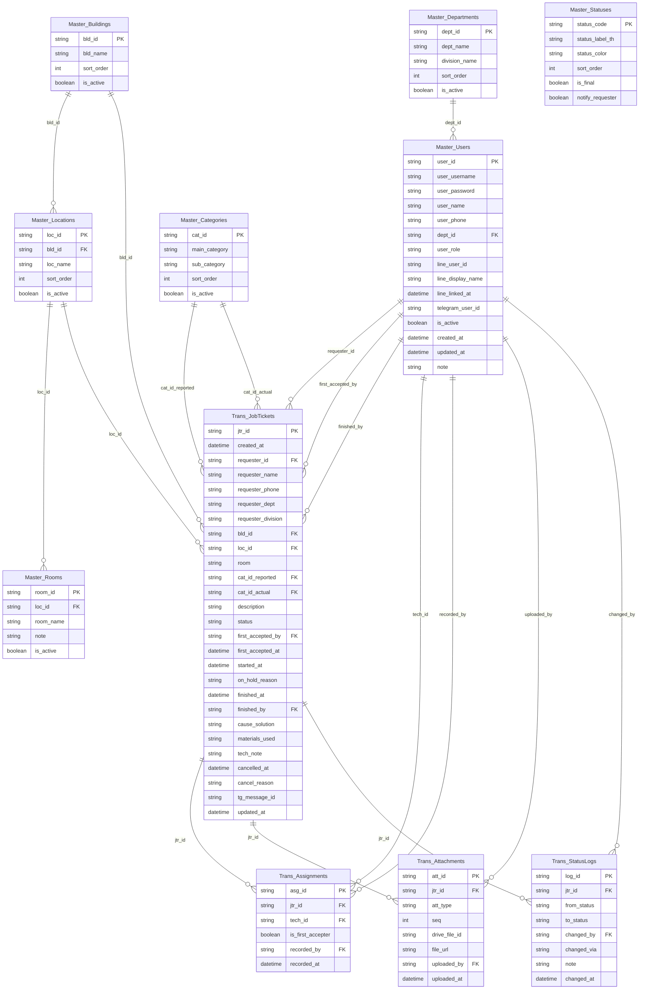

# e-MMS — Database Schema (Google Sheets)

> ไฟล์นี้สร้างอัตโนมัติจาก `apps-script/SetupDatabase.js` ด้วย `node tools/export_schema.js` — อย่าแก้ด้วยมือ

ทั้งหมด **15 ชีต** · คีย์หลักอยู่คอลัมน์ A เสมอ · FK อ้างอิงด้วยรหัส (ไม่ใช่ชื่อ) · ห้ามลบแถว master ให้ใช้ `is_active = FALSE`

## ER Diagram

## Master (ข้อมูลหลัก — admin แก้ใน Google Sheets ได้)

### Master_Users

ผู้ใช้ทุกบทบาท (ผู้แจ้ง / ช่าง / admin) — 1 คน : 1 LINE : 1 Telegram · seed 6 แถว

| คอลัมน์ | ชื่อฟิลด์ | ชนิด | คำอธิบาย |
|---|---|---|---|
| A | `user_id` | id | รหัสผู้ใช้ USER0001 |
| B | `user_username` | text | ชื่อผู้ใช้สำหรับ login ครั้งแรก (นักศึกษา = รหัสนักศึกษา) ห้ามซ้ำ |
| C | `user_password` | text | รหัสผ่าน (วันเดือนปีเกิด ddmmyyyy พ.ศ. แบบเดียวกับ WiFi) |
| D | `user_name` | text | ชื่อ-นามสกุล |
| E | `user_phone` | text | เบอร์โทรศัพท์ (ดึงไปใส่ฟอร์มแจ้งซ่อมอัตโนมัติ แก้ได้ตอนแจ้ง) |
| F | `dept_id` | FK → Master_Departments | สังกัด/ส่วนงาน |
| G | `user_role` | enum | user | technician | admin ค่า: `user` `technician` `admin` |
| H | `line_user_id` | text | LINE User ID (U...) บันทึกอัตโนมัติตอนผูกบัญชีครั้งแรก — ล้างค่าเพื่อให้ผูกใหม่ |
| I | `line_display_name` | text | ชื่อที่แสดงใน LINE (ตอนผูก) |
| J | `line_linked_at` | datetime | วันเวลาที่ผูก LINE |
| K | `telegram_user_id` | text | Telegram user ID (เฉพาะช่าง) ใช้ระบุว่าใครกด "รับงาน" |
| L | `is_active` | bool | FALSE = ปิดการใช้งาน (เช่น นักศึกษาจบแล้ว) |
| M | `created_at` | datetime | วันที่สร้าง |
| N | `updated_at` | datetime | วันที่แก้ไขล่าสุด |
| O | `note` | text | หมายเหตุ |

### Master_Departments

สังกัด → ส่วนงาน (1 แถว = 1 ส่วนงาน) · seed 10 แถว

| คอลัมน์ | ชื่อฟิลด์ | ชนิด | คำอธิบาย |
|---|---|---|---|
| A | `dept_id` | id | รหัส DEP01 |
| B | `dept_name` | text | สังกัด |
| C | `division_name` | text | ส่วนงาน |
| D | `sort_order` | int | ลำดับแสดงผล |
| E | `is_active` | bool | ใช้งาน |

### Master_Buildings

อาคาร/พื้นที่ · seed 17 แถว

| คอลัมน์ | ชื่อฟิลด์ | ชนิด | คำอธิบาย |
|---|---|---|---|
| A | `bld_id` | id | รหัส BLD01 |
| B | `bld_name` | text | ชื่ออาคาร |
| C | `sort_order` | int | ลำดับแสดงผล |
| D | `is_active` | bool | ใช้งาน |

### Master_Locations

ชั้น/บริเวณ ภายในอาคาร (dropdown ขั้นที่ 2) · seed 45 แถว

| คอลัมน์ | ชื่อฟิลด์ | ชนิด | คำอธิบาย |
|---|---|---|---|
| A | `loc_id` | id | รหัส LOC001 |
| B | `bld_id` | FK → Master_Buildings | อาคาร |
| C | `loc_name` | text | ชั้น/บริเวณ เช่น ชั้น 1, บริเวณรอบอาคาร |
| D | `sort_order` | int | ลำดับแสดงผล |
| E | `is_active` | bool | ใช้งาน |

### Master_Rooms

ห้อง (ไม่บังคับ) — ใช้เป็นตัวเลือก autocomplete ร่วมกับห้องที่เคยแจ้งมาแล้ว · seed 2 แถว

| คอลัมน์ | ชื่อฟิลด์ | ชนิด | คำอธิบาย |
|---|---|---|---|
| A | `room_id` | id | รหัส ROOM0001 |
| B | `loc_id` | FK → Master_Locations | ชั้น/บริเวณ |
| C | `room_name` | text | ชื่อ/เลขห้อง เช่น A16, L413 |
| D | `note` | text | หมายเหตุ เช่น หน่วยงานที่ใช้ห้อง |
| E | `is_active` | bool | ใช้งาน |

### Master_Categories

หมวดหลัก → หมวดย่อย ของงานซ่อม (1 แถว = 1 หมวดย่อย) · seed 24 แถว

| คอลัมน์ | ชื่อฟิลด์ | ชนิด | คำอธิบาย |
|---|---|---|---|
| A | `cat_id` | id | รหัส CAT001 |
| B | `main_category` | text | หมวดหลัก |
| C | `sub_category` | text | หมวดย่อย |
| D | `sort_order` | int | ลำดับแสดงผล |
| E | `is_active` | bool | ใช้งาน |

### Master_Statuses

สถานะงาน + ป้ายภาษาไทย + สี + กำหนดว่าสถานะใดแจ้งผู้แจ้งทาง LINE Push · seed 7 แถว

| คอลัมน์ | ชื่อฟิลด์ | ชนิด | คำอธิบาย |
|---|---|---|---|
| A | `status_code` | id | รหัสสถานะ (ห้ามแก้) |
| B | `status_label_th` | text | ป้ายภาษาไทยที่แสดงผล |
| C | `status_color` | text | สี HEX ที่แสดงใน UI/Flex |
| D | `sort_order` | int | ลำดับ |
| E | `is_final` | bool | TRUE = สถานะสิ้นสุด (แก้ไขต่อไม่ได้) |
| F | `notify_requester` | bool | TRUE = ส่ง LINE Push แจ้งผู้แจ้งเมื่อเปลี่ยนเป็นสถานะนี้ |

## Transaction (ระบบเขียนอัตโนมัติ)

### Trans_JobTickets

งานแจ้งซ่อม (1 แถว = 1 งาน) — แทน Master_JobTicketRecords เดิม

| คอลัมน์ | ชื่อฟิลด์ | ชนิด | คำอธิบาย |
|---|---|---|---|
| A | `jtr_id` | id | รหัสงาน JTR-YYMM-NNN เช่น JTR-6910-001 (รันใหม่ทุกเดือน, YY = ปี พ.ศ.) |
| B | `created_at` | datetime | วันเวลาที่แจ้ง |
| C | `requester_id` | FK → Master_Users | ผู้แจ้ง |
| D | `requester_name` | text | snapshot ชื่อผู้แจ้ง ณ วันที่แจ้ง |
| E | `requester_phone` | text | snapshot เบอร์ติดต่อ (แก้ได้ตอนแจ้ง) |
| F | `requester_dept` | text | snapshot สังกัด (ไว้ทำรายงานย้อนหลัง แม้ผู้ใช้ย้ายสังกัด) |
| G | `requester_division` | text | snapshot ส่วนงาน |
| H | `bld_id` | FK → Master_Buildings | อาคาร |
| I | `loc_id` | FK → Master_Locations | ชั้น/บริเวณ |
| J | `room` | text | ห้อง (พิมพ์เอง/autocomplete, ไม่บังคับ) |
| K | `cat_id_reported` | FK → Master_Categories | หมวดที่ผู้แจ้งเลือก |
| L | `cat_id_actual` | FK → Master_Categories | หมวดจริงที่ช่างยืนยันตอนปิดงาน (ค่าเริ่ม = cat_id_reported) |
| M | `description` | longtext | รายละเอียดการแจ้งซ่อม |
| N | `status` | enum | สถานะปัจจุบัน (ดู Master_Statuses) ค่า: `PENDING` `ACCEPTED` `IN_PROGRESS` `ON_HOLD` `COMPLETED` `CANNOT_REPAIR` `CANCELLED` |
| O | `first_accepted_by` | FK → Master_Users | ช่างที่กด "รับงาน" คนแรก |
| P | `first_accepted_at` | datetime | เวลารับงาน → Response time = first_accepted_at − created_at |
| Q | `started_at` | datetime | เวลาเริ่มดำเนินการ (IN_PROGRESS ครั้งแรก) |
| R | `on_hold_reason` | text | เหตุผลที่รอ (รออะไหล่/จัดซื้อ) ล่าสุด |
| S | `finished_at` | datetime | เวลาปิดงาน (COMPLETED / CANNOT_REPAIR) → Repair time = finished_at − first_accepted_at |
| T | `finished_by` | FK → Master_Users | ช่างที่กดปิดงาน |
| U | `cause_solution` | longtext | สาเหตุ / วิธีแก้ไข |
| V | `materials_used` | longtext | วัสดุที่ใช้ (ข้อความ) เช่น หลอด LED 18W x2 |
| W | `tech_note` | longtext | หมายเหตุช่าง / เหตุผลที่ซ่อมไม่ได้ |
| X | `cancelled_at` | datetime | เวลาที่ผู้แจ้งยกเลิก (ได้เฉพาะตอน PENDING) |
| Y | `cancel_reason` | text | เหตุผลการยกเลิก |
| Z | `tg_message_id` | text | message_id ใน Telegram (ใช้แก้ข้อความ/ปุ่มเมื่อสถานะเปลี่ยน) |
| AA | `updated_at` | datetime | แก้ไขล่าสุด |

### Trans_Assignments

ช่างที่ร่วมปฏิบัติงาน (1 แถว = ช่าง 1 คน ต่อ 1 งาน) — บันทึกตอนปิดงานด้วย checkbox — ใช้ทำสถิติรายบุคคล

| คอลัมน์ | ชื่อฟิลด์ | ชนิด | คำอธิบาย |
|---|---|---|---|
| A | `asg_id` | id | รหัส ASG000001 |
| B | `jtr_id` | FK → Trans_JobTickets | งาน |
| C | `tech_id` | FK → Master_Users | ช่างผู้ร่วมงาน |
| D | `is_first_accepter` | bool | TRUE = เป็นคนกดรับงานคนแรก |
| E | `recorded_by` | FK → Master_Users | ผู้บันทึก (ช่างที่ปิดงาน / admin) |
| F | `recorded_at` | datetime | เวลาบันทึก |

### Trans_Attachments

รูปภาพ (ก่อนซ่อม 1-3 รูปจากผู้แจ้ง / หลังซ่อม 1-3 รูปจากช่าง) เก็บไฟล์ใน Google Drive

| คอลัมน์ | ชื่อฟิลด์ | ชนิด | คำอธิบาย |
|---|---|---|---|
| A | `att_id` | id | รหัส ATT000001 |
| B | `jtr_id` | FK → Trans_JobTickets | งาน |
| C | `att_type` | enum | BEFORE = รูปแจ้งซ่อม, AFTER = รูปหลังซ่อม ค่า: `BEFORE` `AFTER` |
| D | `seq` | int | ลำดับรูป 1-3 |
| E | `drive_file_id` | text | Google Drive file ID |
| F | `file_url` | url | ลิงก์รูป (thumbnail/view) |
| G | `uploaded_by` | FK → Master_Users | ผู้อัปโหลด |
| H | `uploaded_at` | datetime | เวลาอัปโหลด |

### Trans_StatusLogs

ประวัติการเปลี่ยนสถานะทุกครั้ง (audit trail + ใช้คำนวณเวลา)

| คอลัมน์ | ชื่อฟิลด์ | ชนิด | คำอธิบาย |
|---|---|---|---|
| A | `log_id` | id | รหัส LOG000001 |
| B | `jtr_id` | FK → Trans_JobTickets | งาน |
| C | `from_status` | enum | สถานะเดิม (ว่าง = สร้างงานใหม่) ค่า: `PENDING` `ACCEPTED` `IN_PROGRESS` `ON_HOLD` `COMPLETED` `CANNOT_REPAIR` `CANCELLED` |
| D | `to_status` | enum | สถานะใหม่ ค่า: `PENDING` `ACCEPTED` `IN_PROGRESS` `ON_HOLD` `COMPLETED` `CANNOT_REPAIR` `CANCELLED` |
| E | `changed_by` | FK → Master_Users | ผู้เปลี่ยน |
| F | `changed_via` | enum | LIFF | TELEGRAM | ADMIN | SYSTEM ค่า: `LIFF` `TELEGRAM` `ADMIN` `SYSTEM` |
| G | `note` | text | หมายเหตุประกอบ |
| H | `changed_at` | datetime | เวลา |

## System (ตั้งค่า/บันทึกระบบ)

### Sys_Config

ค่าตั้งค่าระบบ (key/value) — ความลับ เช่น token ให้เก็บใน Script Properties · seed 21 แถว

| คอลัมน์ | ชื่อฟิลด์ | ชนิด | คำอธิบาย |
|---|---|---|---|
| A | `config_key` | id | ชื่อค่าตั้ง |
| B | `config_value` | text | ค่า |
| C | `description` | text | คำอธิบาย |

### Sys_Counters

ตัวนับเลขรันนิ่ง (ใช้ร่วมกับ LockService ป้องกันรหัสซ้ำ)

| คอลัมน์ | ชื่อฟิลด์ | ชนิด | คำอธิบาย |
|---|---|---|---|
| A | `counter_key` | id | เช่น JTR-6910, ASG, ATT, LOG, USER |
| B | `last_value` | int | เลขล่าสุดที่ใช้ไป |
| C | `updated_at` | datetime | แก้ไขล่าสุด |

### Sys_NotificationLogs

บันทึกการส่งแจ้งเตือนทุกช่องทาง — นับ LINE_PUSH รายเดือนเพื่อคุมโควต้า 300 ข้อความ

| คอลัมน์ | ชื่อฟิลด์ | ชนิด | คำอธิบาย |
|---|---|---|---|
| A | `notif_id` | id | รหัส NTF000001 |
| B | `jtr_id` | FK → Trans_JobTickets | งานที่เกี่ยวข้อง (ว่างได้ เช่น สรุปประจำวัน) |
| C | `channel` | enum | LINE_REPLY (ฟรี) | LINE_PUSH (นับโควต้า) | TELEGRAM ค่า: `LINE_REPLY` `LINE_PUSH` `TELEGRAM` |
| D | `event` | text | เหตุการณ์ เช่น TICKET_CREATED, STATUS_ACCEPTED, DAILY_SUMMARY, QUOTA_WARNING |
| E | `target` | text | ผู้รับ (LINE user ID / Telegram chat ID) |
| F | `result` | enum | SENT | FAILED ค่า: `SENT` `FAILED` |
| G | `error_message` | text | ข้อความ error (ถ้ามี) |
| H | `sent_at` | datetime | เวลาส่ง |

### Sys_AuditLogs

บันทึกเหตุการณ์ด้านบัญชีผู้ใช้ (login, ผูก/ยกเลิก LINE, แก้ไขผู้ใช้)

| คอลัมน์ | ชื่อฟิลด์ | ชนิด | คำอธิบาย |
|---|---|---|---|
| A | `audit_id` | id | รหัส AUD000001 |
| B | `actor_user_id` | text | ผู้กระทำ (ว่าง = ไม่ทราบ เช่น login ผิด) |
| C | `action` | enum | ประเภทเหตุการณ์ ค่า: `LOGIN_SUCCESS` `LOGIN_FAIL` `LINK_LINE` `UNLINK_LINE` `LINK_TELEGRAM` `USER_CREATE` `USER_UPDATE` `USER_DISABLE` |
| D | `target_user_id` | text | ผู้ใช้ที่ถูกกระทำ |
| E | `detail` | text | รายละเอียด เช่น username ที่พยายาม login, LINE display name |
| F | `created_at` | datetime | เวลา |

